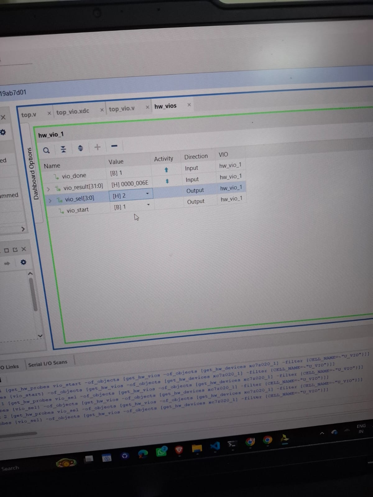

# Dynamic Precision-Scalable Systolic Array using DFX

This project implements a 4×4 output-stationary systolic array for matrix multiplication, the core operation of neural-network inference, on a ZedBoard (Zynq-7020). Using Dynamic Function eXchange (DFX), the array's arithmetic precision (int16, int8 or int4) is hot-swapped at runtime inside a single reconfigurable partition while the rest of the design keeps running. Each precision is a partial bitstream behind one frozen interface: int16 uses DSP slices, while int8 and int4 use LUT fabric. Every variant is checked bit-exact against a Python golden model. One physical region therefore serves several accuracy and resource trade-offs, avoiding dedicated arrays for each precision.

## Status

| Tier | What | Status | Read |
|---|---|---|---|
| **T0** | 4×4 int16 systolic array: datapath, controller, UART system (sim), VIO bring-up (silicon) | ✅ complete | [T0 Complete Guide](docs/t0/T0_Complete_Guide.md) |
| **T1** | DFX mechanism proof: one reconfigurable partition, swap adder ↔ multiplier ↔ greybox over JTAG | ✅ complete on silicon | [T1 Complete Guide](docs/t1/T1_Complete_Guide.md) · [T1 Results](docs/t1/T1_RESULTS.md) |
| T2 | Precision variants (int16 / int8 / int4 array) as reconfigurable modules in the T1 Pblock | on silicon (t2-onboard) | [T2 guide, plain language](docs/t2/T2_Guide_Simple.md) |
| T3 | Runtime precision control and measurement (optionally MNIST) | later | — |

Tags: `t0-datapath`, `t0-system`, `t0-onboard`, `t1-rtl`, `t1-built`, `t1-onboard`, `t2-rtl`, `t2-built`, `t2-onboard`.

## Headline numbers

**T0** (int16 array, 100 MHz; [details](docs/t0/T0_Complete_Guide.md#1-the-result-in-one-page)): 16 DSP48E1, 1,335 LUT, 665 FF (UART system), WNS +0.378 ns (UART) / +1.427 ns (VIO build). On silicon: VIO readout `C[0][2] = 110`, correct.



**T1** (DFX; [details](docs/t1/T1_RESULTS.md)):

| | |
|---|---|
| Partial swap over JTAG | **1,424 ± 27 ms** (N = 15), vs full program 9,060 ± 73 ms (N = 3) |
| Partial bitstream | 585,560 B = **14.5%** of the full 4,045,667 B; the same for every module |
| Static region during swaps | uninterrupted on **15/15** swaps (uptime counter +2 s each; reset only by full programs) |
| Timing @ 100 MHz | WNS +4.304 / +3.501 / +4.304 ns (add / mul / grey), `pr_verify` PASS |
| Pblock (reused by T2) | right part of clock region X1Y1: 4,400 LUT, 8,800 FF, **40 DSP**, 10 BRAM |

## Repo map

```
rtl/            T0 Verilog (pe, array, controller, uart, loader, top, top_vio)
rtl/t1/         T1 static top + reconfigurable modules (rm/rm_add.v, rm/rm_mul.v)
tb/  tb/t1/     self-checking testbenches (T0 / T1)
constraints/    XDC: top.xdc, top_vio.xdc (T0); top_dfx.xdc, top_dfx_pblock.xdc (T1)
python/         golden model, quantisation helpers, vector generator, trace diff, UART host
sim/vectors/    golden test vectors for the T0 benches
scripts/t1/     T1 sims, OOC check, bitstream collector, reports, Hardware Manager + mock harness
bitstreams/t1/  T1 full + partial bitstreams, probes file, manifest.csv
docs/t0/        T0 guide (+ img/)
docs/t1/        T1 guide, results, original plan, board runbook, reports/, img/
vivado/         Vivado projects (gitignored; regenerate from sources)
```

## Quick start

Tools: Python 3 with NumPy, Icarus Verilog (`iverilog`, `vvp`), Vivado 2022.2. Paths must not contain spaces.

**Python setup (once):**
```
py -3 -m venv .venv
.\.venv\Scripts\python.exe -m pip install numpy
```

**T0: golden model and vectors**
```
python python/test_golden.py                          # model self-checks: 14/14 PASS
python python/gen_vectors.py --case all --seed 1      # writes sim/vectors/<case>/
python python/gen_vectors.py --case counting --dump   # one case, with the feed staircase printed
```
The T0 benches (`tb/*.v`) run in XSim or Icarus against `sim/vectors/`. The Vivado flow and board bring-up are in [T0 guide §12–14](docs/t0/T0_Complete_Guide.md#12-fpgas-and-the-vivado-flow).

**T1: DFX**
```
python scripts/t1/run_sims.py                         # 4 benches: ALL PASS
```
The DFX build in Vivado, bitstream collection and reports are in [T1 guide §8 and §13](docs/t1/T1_Complete_Guide.md#13-how-to-reproduce-t1-from-a-clean-clone). The committed bitstreams in `bitstreams/t1/` can be used directly. On the board (Vivado Tcl console; full steps in the [runbook](docs/t1/T1_BOARD_RUNBOOK.md)):
```tcl
source D:/Projects/RC_Project/scripts/t1/hw_t1.tcl
t1_connect ; t1_program full add ; t1_swap_demo mul ; t1_selftest
```
Dry run without a board: from `vivado/`, `vivado -mode batch -nojournal -nolog -source ../scripts/t1/hw_t1_mock.tcl` → `MOCK TESTS PASS`.

## Documentation

- [T0 guide](docs/t0/T0_Complete_Guide.md)
- [T1 guide](docs/t1/T1_Complete_Guide.md)
- [T2 guide, plain language](docs/t2/T2_Guide_Simple.md)
- [T2 board runbook and session record](docs/t2/T2_BOARD_RUNBOOK.md)
