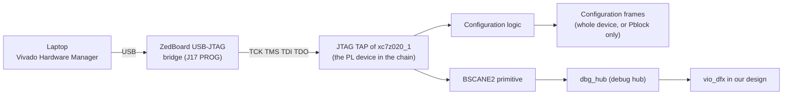
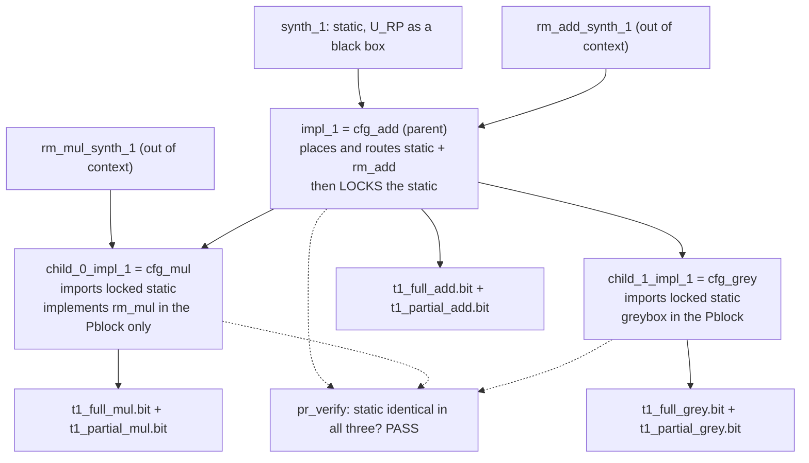
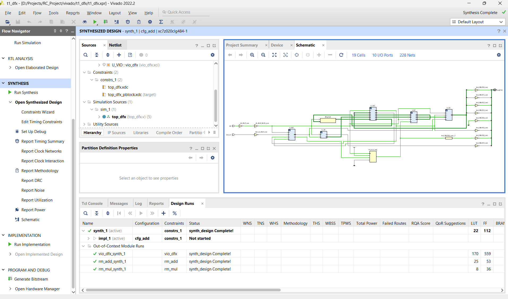
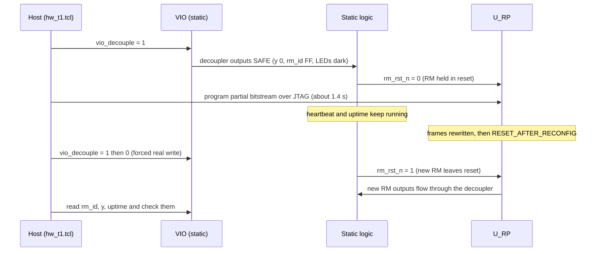
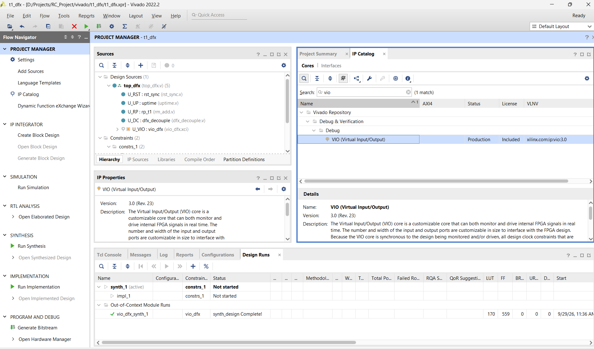
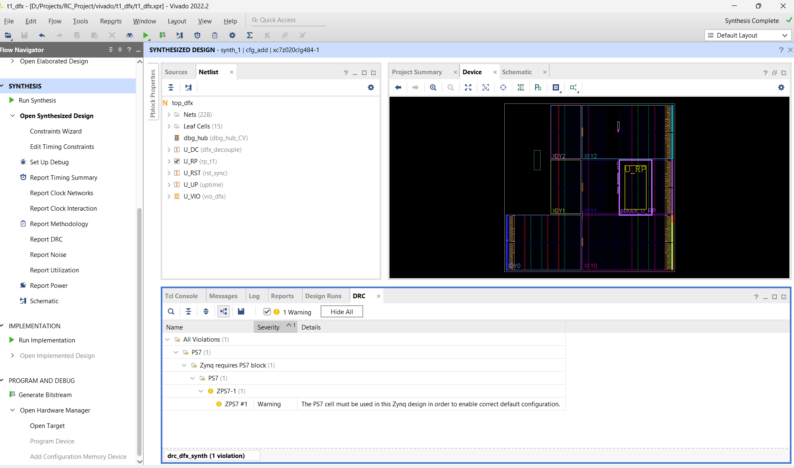

# T1 Complete Guide
## Swapping Hardware While It Runs: Dynamic Function eXchange on the ZedBoard

**Project:** Precision-scalable systolic matrix multiplier (Reconfigurable Computing, CS G553, BITS Hyderabad)
**Board:** ZedBoard, Zynq-7000 `xc7z020clg484-1` · **Tools:** Vivado 2022.2 (project mode), Icarus Verilog, Python 3
**Repo:** https://github.com/Karthik-Flash/systolic_array · tags `t1-rtl` → `t1-built` → `t1-onboard`
**Status:** T1 complete. Simulated, implemented in three configurations at 100 MHz, and proven on physical silicon: 15 out of 15 partial swaps, with the rest of the chip running throughout.

Companion documents: [T1_RESULTS.md](T1_RESULTS.md) (every number, with its source), [T1_PLAN.md](T1_PLAN.md) (the original spec), [T1_BOARD_RUNBOOK.md](T1_BOARD_RUNBOOK.md) (board session steps), [T0 Complete Guide](../t0/T0_Complete_Guide.md) (the systolic array itself).

---

## Contents

1. [The result in one page](#1-the-result-in-one-page)
2. [Recap from T0: FPGAs in five minutes](#2-recap-from-t0-fpgas-in-five-minutes)
3. [How an FPGA is configured](#3-how-an-fpga-is-configured)
4. [Dynamic Function eXchange from scratch](#4-dynamic-function-exchange-from-scratch)
5. [The T1 design](#5-the-t1-design)
6. [The arithmetic, for beginners](#6-the-arithmetic-for-beginners)
7. [Verification before hardware](#7-verification-before-hardware)
8. [The Vivado DFX flow, as actually done](#8-the-vivado-dfx-flow-as-actually-done)
9. [On the board](#9-on-the-board)
10. [Measurements and analysis](#10-measurements-and-analysis)
11. [Bugs and lessons](#11-bugs-and-lessons)
12. [What T1 means for T2](#12-what-t1-means-for-t2)
13. [How to reproduce T1 from a clean clone](#13-how-to-reproduce-t1-from-a-clean-clone)
14. [File map](#14-file-map)
15. [Glossary](#15-glossary)

---

## 1. The result in one page

**Dynamic Function eXchange (DFX)** is Xilinx's name for *partial reconfiguration*: rewriting the hardware in one region of an FPGA while the rest of the chip keeps running.

T1 proves that DFX works on this board, with this toolchain, without the ARM processor, over a single USB cable. We carved out one rectangle of the chip, the **reconfigurable partition** `U_RP`. We built three things that can live in it: an adder (`rm_add`), a multiplier (`rm_mul`) and an empty "greybox". Then we swapped between them at runtime. A seconds counter in the rest of the chip (`vio_uptime`) kept counting straight through every swap. That counter is the proof: if the swap had secretly reprogrammed the whole chip, the counter would have restarted at zero, as it does when we load the full bitstream on purpose.

| What | Result | Source |
|---|---|---|
| Partial swap time over JTAG | **1,424 ± 27 ms** (N = 15) | `reports/hw_selftest_20261008_160232.csv` |
| Full program time over JTAG | **9,060 ± 73 ms** (N = 3) | same CSV |
| Partial bitstream size | **585,560 B = 14.5%** of the full 4,045,667 B | `bitstreams/t1/manifest.csv` |
| Swaps with static logic uninterrupted | **15 / 15** (uptime +2 s across every one) | self-test CSV |
| Full programs that reset uptime | 2 / 2 measurable (rows 2–3) | self-test CSV |
| Correct `rm_id` and all 7 test vectors after every swap | 18 / 18 self-test rows PASS | self-test CSV |
| Timing at 100 MHz, `cfg_add` | WNS **+4.304 ns**, WHS +0.039 ns | `reports/cfg_add_timing_summary.rpt` |
| Timing at 100 MHz, `cfg_mul` | WNS **+3.501 ns**, WHS +0.039 ns | `reports/cfg_mul_timing_summary.rpt` |
| Timing at 100 MHz, `cfg_grey` | WNS **+4.304 ns**, WHS +0.039 ns | `reports/cfg_grey_timing_summary.rpt` |
| `pr_verify` (all three share one static) | **PASS** | `reports/pr_verify.rpt` |
| Pblock capacity | 4,400 LUT / 8,800 FF / **40 DSP** / 10 BRAM | `reports/cfg_*_utilization_pblock.rpt` |
| Static region cost | 636 LUT / 1,412 FF / 0 DSP (≈ 97% of the LUTs are debug cores) | `reports/cfg_grey_utilization*.rpt` |

The one-sentence conclusion: **a swap takes about 1.4 s over JTAG, the time depends only on the size of the rectangle and not on what is inside it, and the rest of the chip never notices.**

---

## 2. Recap from T0: FPGAs in five minutes

The [T0 guide](../t0/T0_Complete_Guide.md) explains all of this in depth (Sections 2, 12 and 14 there). Here is the minimum you need for T1.

An **FPGA** (Field-Programmable Gate Array) is a chip full of small, generic building blocks and a programmable wiring network. A configuration file, the **bitstream**, decides what each block does and how they are wired. Load a different bitstream and the same chip becomes a different circuit.

| Block | What it is | xc7z020 has |
|---|---|---|
| **LUT** (look-up table) | a 6-input truth table: any small logic function | 53,200 |
| **FF** (flip-flop) | a 1-bit register that updates on the clock edge | 106,400 |
| **CARRY4** | a fast carry chain for adders and counters | — |
| **DSP48E1** | a hard 25×18 multiplier with a 48-bit adder/accumulator | 220 |
| **BRAM** (block RAM) | 36 Kb memory block | 140 |
| **BUFG** | global clock buffer driving a low-skew clock network | 32 |

The Zynq is two chips in one package: the **PS** (Processing System: two ARM cores, DDR controller, peripherals) and the **PL** (Programmable Logic: the FPGA fabric). This project is **PL-only**: the ARM side is never configured or used.

Because of that, the laptop talks to the design over **JTAG** (a 4-wire test and programming interface, reached through the board's USB "PROG" port, J17). The same cable carries two kinds of traffic:
- **bitstreams**, sent by Vivado's Hardware Manager to configure the chip;
- **VIO** traffic. VIO (Virtual Input/Output) is a Xilinx debug core inside our design. It gives the laptop virtual switches (outputs into the design) and virtual displays (inputs from the design).

T0 used VIO to read the systolic array's results. T1 uses it to drive the adder/multiplier inputs, read results, read the uptime counter and trigger the swap protocol.

---

## 3. How an FPGA is configured

### 3.1 Configuration memory

Every LUT's truth table, every routing switch and every flip-flop's initial value is set by a bit in the FPGA's **configuration memory**. This is an SRAM array spread over the whole die, separate from your design's own registers. It is volatile, so it is empty at power-up. Configuring the chip means writing that memory.

### 3.2 Frames

On 7-series devices (the Zynq-7000 PL is 7-series fabric) the configuration memory is not written bit by bit. It is written in **frames**, the smallest addressable unit (Xilinx UG470, *7 Series FPGAs Configuration User Guide*). A frame is a fixed-length block of configuration words (UG470 gives 101 32-bit words for 7-series). It configures a thin vertical slice of one column of resources (CLBs, DSPs or BRAMs), **one clock region tall**.

That last detail matters for DFX. Each column of the die is divided vertically into clock regions (on this part, three rows, `Y0`–`Y2`, of 50 CLBs each). A frame never spans two clock regions. So the natural unit of "a piece of the chip I can rewrite" is a rectangle whose top and bottom edges sit on clock-region boundaries.

```
        column of CLBs  →  one frame configures one column, one clock region tall
   ┌────┬────┬────┬────┬────┐
   │    │    │    │    │    │  clock region row Y2
   ├────┼────┼────┼────┼────┤  ← frame boundary
   │ ▓▓ │ ▓▓ │    │    │    │  clock region row Y1   ▓ = frames a partial rewrites
   ├────┼────┼────┼────┼────┤  ← frame boundary
   │    │    │    │    │    │  clock region row Y0
   └────┴────┴────┴────┴────┘
```

### 3.3 The configuration engine and the JTAG path

The chip contains dedicated **configuration logic**: a small state machine that receives a bitstream, checks it, and writes frames to the addresses the bitstream specifies. It can be fed through several ports:
- external pins (from flash at boot);
- **JTAG**, which we use;
- **ICAP** (Internal Configuration Access Port), a primitive the fabric itself can drive;
- on Zynq, **PCAP** (Processor Configuration Access Port), driven by the ARM side.

Our path has no processor and no ICAP:



The same TAP also reaches our design's VIO, through a **BSCANE2** primitive (a hook that lets user logic sit on the JTAG chain) and the **debug hub** (`dbg_hub`) that Vivado inserts automatically. That is why one cable does both programming and interaction. Hardware Manager's JTAG chain shows two devices: `arm_dap_0` (the PS debug port, which we never touch) and `xc7z020_1` (the PL).

### 3.4 Full versus partial bitstreams

A **full bitstream** first clears the whole configuration memory, then writes every frame on the device. While that happens no user logic runs: the clock network, the counters and the LEDs all stop, and the **DONE** pin (and the board's DONE LED) goes low until configuration finishes. Afterwards every flip-flop starts again from its initial value. Our full bitstreams are all exactly 4,045,667 bytes (`manifest.csv`). The size is set by the device, not by the design: `t1_full_add.bit`, `t1_full_mul.bit` and `t1_full_grey.bit` are identical in size.

A **partial bitstream** skips the clear. It writes only the frames inside one rectangle (Section 4). Everything outside keeps its configuration and keeps running. Ours are 585,560 bytes, 14.5% of a full one.

---

## 4. Dynamic Function eXchange from scratch

### 4.1 The analogy

Think of renovating one room of a house while everyone else stays home. You must:
- **wall off the room** (a fixed boundary, so the builders don't wander into the kitchen);
- **keep the doorways in the same places** (the rest of the house still expects the door where it was);
- **switch off the room's sockets while you work** (so nothing plugged in from outside gets a shock);
- **check the new room against the house plans** (the doors line up and the wiring outside wasn't touched);
- **keep the power on everywhere else**: the fridge keeps humming and the clock on the kitchen wall keeps ticking.

Every item has a precise DFX counterpart.

### 4.2 The precise version

| DFX term | Meaning | T1 name |
|---|---|---|
| **Static region** | All logic that is never reconfigured and keeps running during a swap | everything in `top_dfx` except `U_RP`: VIO, reset sync, uptime/heartbeat, decoupler, LED drivers, clock |
| **Reconfigurable Partition (RP)** | A hierarchical instance whose contents can be swapped | instance `U_RP` of module `rp_t1` |
| **Partition Definition (PD)** | Vivado's name for "the set of things that may live in this RP" | `pd_t1` |
| **Reconfigurable Module (RM)** | One concrete implementation of the RP | `rm_add` (`rtl/t1/rm/rm_add.v`), `rm_mul` (`rtl/t1/rm/rm_mul.v`) |
| **Greybox** | An empty RM generated by Vivado: outputs tied to constant 0, inputs terminated | the greybox option of `pd_t1` |
| **Partition pins** | Fixed routing points where static wires meet RP wires; identical for every RM | 78 of them (`Total PPLOCs 78` in `reports/*_utilization_hier.rpt`) |
| **Pblock** | A rectangle of the die the RP is confined to; its frames are what the partial rewrites | `pblock_U_RP` |
| **Configuration** | One complete design: static + one choice per RP | `cfg_add`, `cfg_mul`, `cfg_grey` |
| **Parent / child runs** | The parent implements static + the first RM and **locks** the static; children reuse the locked static with other RMs | parent `impl_1` (`cfg_add`); children `child_0_impl_1` (`cfg_mul`), `child_1_impl_1` (`cfg_grey`) |
| **Full / partial bitstream** | Whole device / only the Pblock's frames | `t1_full_*.bit` / `t1_partial_*.bit` |
| **`pr_verify`** | Vivado command that checks all configurations share an *identical* static region (placement and routing) | `reports/pr_verify.rpt`: PASS |
| **Decoupling** | Static logic that isolates the RP's outputs while the RP is being rewritten | `dfx_decouple` (instance `U_DC`) + VIO `vio_decouple` |
| **RESET_AFTER_RECONFIG** | Pblock property: after a partial load, the configuration logic resets all flip-flops inside the Pblock to their initial values | set to `true` on `pblock_U_RP` |

The analogy mapped: the wall is the **Pblock**; the doorways are the **partition pins**; switching off the sockets is **decoupling**; checking against the plans is **`pr_verify`**; the clock on the kitchen wall is **`vio_uptime`**.

### 4.3 The frozen-interface rule

Every RM of `pd_t1` must have *exactly* the same module name (`rp_t1`) and *exactly* the same port list. The static region was placed and routed once, with its wires ending at the 78 partition pins. A new RM is only legal if it uses the same doors. That is why both `rm_add.v` and `rm_mul.v` declare `module rp_t1` with a port list that is identical character for character. It also explains a Vivado gotcha: you can never add both files to the normal sources, because two modules with the same name collide (Section 8.2).

### 4.4 Parent and child runs, and the locked static



Because the children reuse the parent's static *exactly*, any partial from any run can be loaded on top of any full from the same build. The flip side is the **consistency rule**: if `impl_1` is ever re-run, every child run and every partial is stale. `scripts/t1/collect_bitstreams.py` refuses to collect a set where a child's bitstream is older than `impl_1`'s routed checkpoint.

### 4.5 Why decoupling *and* reset

While its frames are being rewritten, the RP's outputs are meaningless: half-configured LUTs drive whatever their partial truth tables say. Two independent mechanisms protect the static side and make the new RM start clean:

1. **Decoupler** (static logic): while `vio_decouple = 1`, the static side sees fixed safe values (`y = 0`, `rm_id = FF`, `led_pat = 0`) instead of the RP outputs.
2. **Reset**, in two forms:
   - the static-driven `rm_rst_n` holds the RM in reset while decoupled;
   - `RESET_AFTER_RECONFIG` has the silicon re-initialise every flip-flop in the Pblock after the partial load.

Either reset alone would work. Using both means a mistake in one doesn't break the swap. The RTL also guards the one state a power-up initialisation could get wrong: if `rm_mul`'s walking-one pattern ever starts at `0000`, it reloads `0001` (Section 5.4).

---

## 5. The T1 design

### 5.1 Architecture

```
                                   top_dfx   (STATIC region)
 clk  (Y9, 100 MHz) ──IBUF/BUFG──►──────────────────────────────────────── clk to all
 btn_rst (P16, BTNC, act-high) ─► U_RST rst_sync (2-FF) ─► sys_rst_n   (press = reset, release = run)

 ┌──────── U_VIO : vio_dfx (JTAG) ──┐
 │ probe_out0  vio_decouple   [0]   │──┐
 │ probe_out1  vio_rm_rst     [0]   │──┤  rm_rst_n <= sys_rst_n & ~vio_decouple & ~vio_rm_rst  (registered)
 │ probe_out2  vio_a        [15:0]  │──┼───────────────►┌──────────────────────────────────┐
 │ probe_out3  vio_b        [15:0]  │──┼───────────────►│ U_RP : rp_t1  (RECONFIGURABLE)   │ inside pblock_U_RP
 │                                  │  │                │  rm_add  |  rm_mul  |  greybox   │
 │ probe_in0   vio_y        [31:0]  │◄─┼──┐             └───┬──────────┬───────────┬───────┘
 │ probe_in1   vio_rm_id     [7:0]  │◄─┼──┤         y[31:0] │ rm_id[7:0]│ led_pat[3:0]
 │ probe_in2   vio_uptime   [31:0]  │◄─┼┐ │                 ▼           ▼           ▼
 └──────────────────────────────────┘  ││ │           ┌───── U_DC : dfx_decouple (registered) ─────┐
                                       ││ └───────────│ decouple=1: y→0, rm_id→FF, led_pat→0       │
            U_UP uptime (seconds) ─────┘│             │ decouple=0: pass RM outputs through        │
            heartbeat (1 Hz)            └─ vio_decouple└────────────────────────────────────────────┘
 LEDs:  LD3..0 = RM pattern (after decoupler)   LD4 = 0
        LD5 = decouple active   LD6 = RM held in reset (~rm_rst_n)   LD7 = heartbeat
```

Vivado's schematic of the synthesized design (U_RST, U_UP, U_VIO, U_RP, U_DC and the automatically inserted `dbg_hub`), with the run table showing the out-of-context synthesis runs:



### 5.2 Static blocks, one by one

**`rtl/t1/rst_sync.v`, the reset synchroniser.**

```verilog
module rst_sync (
    input  wire clk,
    input  wire btn_rst,                       // BTNC, active high, asynchronous
    output wire rst_n                          // synchronous, active low
);
    (* ASYNC_REG = "TRUE" *) reg [1:0] sync;
    always @(posedge clk) sync <= {sync[0], ~btn_rst};
    assign rst_n = sync[1];
endmodule
```

Why each choice:
- **Inversion inside.** BTNC reads 1 when pressed; the design wants an active-low reset. T0 initially got this backwards and only ran while the button was held (T0 bug #8). Here, pressed = reset and released = run, so the board runs with no button touched.
- **Two flops.** The button is asynchronous to the clock, and sampling it directly risks metastability. Two flops in series give the first one a full cycle to settle. `ASYNC_REG` tells Vivado to place them close together.
- **Power-up behaviour.** Flops start at 0 after configuration, so `rst_n` is low for the first two cycles: a free power-on reset.

**`rtl/t1/uptime.v`, seconds counter and heartbeat.** It counts clock cycles. Every `TICK_DIV/2` cycles (0.5 s at 100 MHz) it toggles `heartbeat` (LD7), and every `TICK_DIV` cycles it increments `seconds`. `seconds` is wired to `vio_uptime`, and it is **the evidence of T1**. It sits in the static region, so a partial must never disturb it, while a full program must reset it to 0. The parameter `TICK_DIV` is 100,000,000 on hardware and 100 in simulation, so the bench sees a "second" every 100 cycles.

**`rtl/t1/dfx_decouple.v`, the decoupler.**

```verilog
module dfx_decouple #(
    parameter W      = 44,                     // 32 y + 8 rm_id + 4 led_pat
    parameter [W-1:0] SAFE = {32'h0000_0000, 8'hFF, 4'b0000}
) ( input clk, input rst_n, input decouple,
    input [W-1:0] rp_out, output reg [W-1:0] safe_out );
    always @(posedge clk) begin
        if (!rst_n || decouple) safe_out <= SAFE;
        else                    safe_out <= rp_out;
    end
endmodule
```

Why each choice:
- **Registered.** The static side always sees a flop output, never a combinational path from a half-configured RP. This also cuts the timing path at the partition boundary.
- **`rm_id = FF` while decoupled.** No RM ever reports `FF`, so reading `FF` over VIO unambiguously means "isolated", not "greybox" (`00`) or a loaded RM (`A1`/`B2`).
- **Parameterised `W` and `SAFE`.** T2 reuses the module with a different width.

**Top-level glue (`rtl/t1/top_dfx.v`).** One registered line builds the RM reset:

```verilog
reg rm_rst_n;
always @(posedge clk) rm_rst_n <= sys_rst_n & ~vio_decouple & ~vio_rm_rst;
```

Decoupling *also* holds the RM in reset, so one VIO action does both. `vio_rm_rst` alone lets you test the reset path without decoupling (which session 1 did: LD6 + LD7 on).

**VIO probes.** `vio_dfx` has 3 inputs (32, 8, 32 bits: `vio_y`, `vio_rm_id`, `vio_uptime`) and 4 outputs (1, 1, 16, 16 bits: `vio_decouple`, `vio_rm_rst`, `vio_a`, `vio_b`). It is a new core, separate from T0's `vio_0`, and it lives in the static region. **Debug cores must never be inside an RM**: they would vanish with the first swap.

**LED map.**

| LED | Signal | Meaning |
|---|---|---|
| LD3..LD0 | `led_pat` after the decoupler | which RM is loaded (binary count = add, walking one = mul, dark = greybox or decoupled) |
| LD4 | 0 | reserved |
| LD5 | `vio_decouple` | RP isolated |
| LD6 | `~rm_rst_n` | RM held in reset |
| LD7 | `heartbeat` | static region alive (1 Hz) |

### 5.3 The RP interface

```verilog
module rp_t1 #(
    parameter PRESCALE_W = 24                  // led_pat step every 2^24 cycles (~0.17 s @ 100 MHz); tb overrides
) (
    input  wire        clk,
    input  wire        rst_n,                  // synchronous, active low (driven by static)
    input  wire [15:0] a,                      // two's complement
    input  wire [15:0] b,                      // two's complement
    output reg  [31:0] y,                      // registered
    output wire [7:0]  rm_id,                  // RM signature
    output wire [3:0]  led_pat                 // RM LED pattern
);
```

Inputs 1 + 1 + 16 + 16 = 34, outputs 32 + 8 + 4 = 44, total **78 partition pins**. The datapath has the same shape as a T0 processing element (two signed 16-bit operands, a 32-bit result), so T1 also rehearses T2: one RM that needs a DSP and one that must not use one, both in the same Pblock.

| | `rm_add` | `rm_mul` | greybox |
|---|---|---|---|
| `y` | `sext(a) + sext(b)` | `a × b` (signed 16×16 → 32) | 0 |
| `rm_id` | `A1` | `B2` | `00` |
| `led_pat` | 4-bit binary counter | walking one `0001 → 0010 → 0100 → 1000 → …` | `0000` |
| DSP48E1 | 0 | 1 | 0 |

### 5.4 Inside an RM

`rm_id` comes from an 8-bit register marked `dont_touch`, reset to `00` and loaded with the RM's signature every cycle out of reset. Two reasons:
- Every RP output pin is then driven by a real flop inside the RP, never by a constant. Vivado warns about constant-driven partition pins.
- Reading `00` vs `A1`/`B2` shows the RM's reset release over VIO.

`led_pat` comes from a free-running `PRESCALE_W`-bit prescaler. Whenever it wraps (`&pre`), the pattern steps: `pat + 1` in `rm_add`, rotate-left in `rm_mul`. `rm_mul` also has a self-heal: `if (pat == 4'b0000) pat <= 4'b0001;`. If the RM ever started from all-zero flops, the walking one would otherwise stay dark forever.

### 5.5 The swap protocol



---

## 6. The arithmetic, for beginners

### 6.1 Two's complement and sign extension

A 16-bit register holds bit patterns `0x0000`…`0xFFFF`. In **two's complement** the top bit carries a *negative* weight (−32,768), so the same patterns mean −32,768…+32,767:

```
  0x0003 = 0000 0000 0000 0011 = +3
  0xFFFD = 1111 1111 1111 1101 = -32768 + 32765 = -3
  0x7FFF = 0111 1111 1111 1111 = +32767   (largest)
  0x8000 = 1000 0000 0000 0000 = -32768   (most negative)
```

To widen a signed number from 16 to 32 bits without changing its value, copy the top bit into all the new bits. This is **sign extension**:

```
  -3 :  0xFFFD      ->  0xFFFF_FFFD   (correct: still -3)
                    ->  0x0000_FFFD   (WRONG: this is +65,533)
  +3 :  0x0003      ->  0x0000_0003
```

`rm_add` does exactly this in Verilog: `{{16{a[15]}}, a}` means "16 copies of `a`'s top bit, then `a`".

### 6.2 How wide must the results be?

- **Sum.** Two 16-bit signed numbers add to something between −32,768 + −32,768 = −65,536 and 32,767 + 32,767 = 65,534. A 16-bit register can't hold 65,534, but a **17-bit** signed register (±65,536) can. One extra bit is always enough for a sum. We store it in 32 bits, so the upper 15 bits are just more sign copies. That fact matters in Section 6.5.
- **Product.** Two 16-bit signed numbers multiply to something between −32,768 × 32,767 = −1,073,709,056 and (−32,768)² = +1,073,741,824 = 2³⁰. That needs **32** signed bits (31 would top out at 2³⁰ − 1). An *n*×*n*-bit signed product needs 2*n* bits, and the single case that needs the last bit is (−32,768)².

### 6.3 Every test vector, by hand

These are T1_PLAN §6.1. They were re-derived in Python before any RTL was written, and the same seven vectors run in the simulation benches and on silicon (`t1_check` in `scripts/t1/hw_t1.tcl`).

| a (hex) | b (hex) | a, b | a + b | `rm_add` y | a × b | `rm_mul` y |
|---|---|---|---|---|---|---|
| 0003 | 0004 | 3, 4 | 7 | 0000_0007 | 12 | 0000_000C |
| FFFD | 0004 | −3, 4 | 1 | 0000_0001 | −12 | FFFF_FFF4 |
| 0007 | FFFA | 7, −6 | 1 | 0000_0001 | −42 | FFFF_FFD6 |
| 7FFF | 7FFF | 32767, 32767 | 65,534 | 0000_FFFE | 1,073,676,289 | 3FFF_0001 |
| 8000 | 8000 | −32768, −32768 | −65,536 | FFFF_0000 | 1,073,741,824 | 4000_0000 |
| 8000 | 7FFF | −32768, 32767 | −1 | FFFF_FFFF | −1,073,709,056 | C000_8000 |
| 0000 | 0000 | 0, 0 | 0 | 0000_0000 | 0 | 0000_0000 |

Worked details:
- **−3 + 4:** `0xFFFF_FFFD + 0x0000_0004 = 0x1_0000_0001`. The carry out of bit 31 falls off the 32-bit register, leaving `0x0000_0001` = 1. That dropped carry is how two's complement makes subtraction "just addition".
- **−3 × 4 = −12:** a negative 32-bit value is stored as 2³² minus its magnitude. 2³² − 12 = 4,294,967,284 = `0xFFFF_FFF4`.
- **7 × −6 = −42:** 2³² − 42 = `0x1_0000_0000 − 0x2A` = `0xFFFF_FFD6`.
- **32,767 + 32,767 = 65,534 = `0x0000_FFFE`:** bit 15 is set, but the value is positive. This is the case a 16-bit result would get wrong (it would read as −2). Bits 31..16 are 0 because the 17-bit result is positive.
- **32,767² = 1,073,676,289 = `0x3FFF_0001`**.
- **(−32,768)² = 2³⁰ = `0x4000_0000`:** the largest possible product. It is still below 2³¹ − 1 = 2,147,483,647, so it does not overflow 32 signed bits: the top bit is 0 and the value is correctly positive.
- **−32,768 + 32,767 = −1 = `0xFFFF_FFFF`**; **−32,768 × 32,767 = −1,073,709,056 = `0xC000_8000`**.

### 6.4 How the hardware maps

**`rm_add`** synthesises to LUTs plus a **CARRY4** chain. Each CARRY4 handles 4 bits of the addition with dedicated fast carry logic, so no DSP is needed. The module carries `(* use_dsp = "no" *)` to make sure. OOC synthesis: **25 LUT, 53 FF, 0 DSP**. The 53 FFs are y (17 distinct bits, see 6.5) + `id_q` 8 + prescaler 24 + `pat` 4 = 53.

**`rm_mul`** maps to one **DSP48E1**:

```
             ┌──────────────── DSP48E1 ────────────────┐
  a ─(16)───►┤ A (25b, sign-extended) ─┐               │
             │                         ├─►[ 25×18 mult ]─►[ P register ]─┼─► y[31:0]
  b ─(16)───►┤ B (18b, sign-extended) ─┘               │   (PREG = 1)  │
             └─────────────────────────────────────────┘
  AREG = BREG = MREG = 0: inputs and the multiplier stage are not registered
```

OOC synthesis: **8 LUT, 36 FF, 1 DSP**. The 36 FFs are prescaler 24 + `id_q` 8 + `pat` 4. The 32-bit `y` register doesn't appear as fabric flops because Vivado absorbed it into the DSP's **P register**. The implemented DRC confirms the layout: `DPIP-1` says the A and B inputs aren't pipelined, and `DPOP-2` says MREG = 0 (`reports/cfg_mul_drc.rpt`).

### 6.5 Three lessons hidden in the utilisation numbers

**The `use_dsp` lesson.** The plan put `(* use_dsp = "yes" *)` on the whole `rm_mul` module. OOC synthesis then reported **2 DSPs**. On a module, `use_dsp = "yes"` doesn't only mean "multipliers in DSPs"; it also pushes *adders* into DSPs, so the 24-bit prescaler incrementer took a second DSP48E1. The fix was to put the attribute on the product signal alone:

```verilog
(* use_dsp = "yes" *) wire signed [31:0] prod;   // attribute on the signal, not the module
assign prod = $signed(a) * $signed(b);           // declaration and assign split: see Section 11
```

After the fix, OOC gave exactly 1 DSP. For T2 this matters a lot: a DSP-count comparison between precision variants is only meaningful if the attributes count what you think they count.

**Why the routed `rm_add` has 20 LUT1s.** The sum is a 17-bit signed number stored in 32 bits, so y[31:17] are always equal to y[16]. Synthesis notices and keeps one flop for all of them: 32 − 15 = 17 y flops, which matches the 53 FF total. But each of y[31:16] is a separate **partition pin**, and in the routed design the RM grows from 25 LUTs (OOC) to **40** (`reports/cfg_add_utilization_U_RP.rpt`, which shows 20 LUT1s). The +15 equals the 15 merged bits. The most likely explanation is that Vivado inserts a LUT1 buffer so that each partition pin has its own driver. The reports don't state the reason explicitly, so treat it as a well-supported inference.

**Why the greybox has 77 LUT1s.** The greybox is generated by Vivado, not written by us. Each of the **44 output** pins is driven by a LUT1 tied to constant 0. Each of the **33 non-clock inputs** (a 16 + b 16 + rst_n) is terminated in a LUT1 load, so the static-side route ends somewhere. 44 + 33 = 77. One FDCE is the clock pin's load (`reports/cfg_grey_utilization_U_RP.rpt`).

---

## 7. Verification before hardware

T1 followed T0's rule: nothing reaches Vivado until it passes self-checking simulation, and nothing reaches the board until the scripts that drive it have been exercised.

### 7.1 Simulation (`scripts/t1/run_sims.py`)

Four Icarus Verilog builds (`iverilog -g2005`), outputs in `sim/t1_build/`:

| Bench | RM | Checks |
|---|---|---|
| `tb/t1/tb_rp_t1.v` | add, mul (`-DRM_ADD` / `-DRM_MUL`) | reset values; `rm_id` after release; all 7 vectors (1-cycle latency); LED pattern steps exactly every 2^PRESCALE_W cycles over 6 steps (`PRESCALE_W = 4` in sim) |
| `tb/t1/tb_top_dfx.v` + `tb/t1/vio_dfx_stub.v` | add, mul | design runs with the button released; all vectors through the VIO stub (2-cycle latency: RM register + decoupler register); decouple → y 0, `rm_id` FF, LEDs; uptime ticks every 100 cycles **and keeps ticking while decoupled**; heartbeat half-period 50 cycles; `vio_rm_rst` path |

`vio_dfx_stub.v` is a simulation-only module with the same ports as the VIO IP. The bench drives its outputs hierarchically (`dut.U_VIO.probe_out2 = 16'h0003;`). It must never be added to Vivado.

Result: **ALL PASS, 0 warnings.** Then a **negative test**: compiling the mul bench against `rm_add.v` makes both benches FAIL (20 and 14 errors). The benches can tell the RMs apart, so a pass means something.

Icarus can't simulate a runtime swap. Running the same static bench against each RM is the simulation-side equivalent; the real swap is tested on silicon.

### 7.2 Out-of-context synthesis (`scripts/t1/ooc_check.tcl`)

Before the GUI flow, each RM was synthesised on its own (`synth_design -mode out_of_context -top rp_t1`). Result: `rm_add` **25 LUT / 53 FF / 0 DSP**, `rm_mul` **8 LUT / 36 FF / 1 DSP**. This is where the `use_dsp` surprise (2 DSPs) was caught, before it could cost a 15-minute DFX build.

### 7.3 The mock-mode Tcl harness (`scripts/t1/hw_t1_mock.tcl`)

The board script `hw_t1.tcl` would otherwise first run on the board, where a Tcl typo costs a session. So all Hardware Manager calls go through four thin wrappers (`t1_hw_connect`, `t1_hw_program`, `t1_hw_write`, `t1_hw_read`). With `::T1_MOCK 1` they drive a small simulated device instead:
- it tracks which bitstream is loaded: a full resets uptime; a partial sets `rm_id`/`y` behaviour and keeps uptime;
- uptime runs from a virtual clock;
- decouple forces `rm_id FF`, `y 0`;
- program times are proportional to file size (9,000 ms for a full).

`hw_t1_mock.tcl` runs every procedure in Vivado's own Tcl (8.5, the same interpreter the board uses). Then it runs a **negative mock**, where a "partial" also resets uptime, and requires the self-test to FAIL. It caught two real bugs:

1. **Octal hex.** A line like `expr {$i == 0 ? "" : [t1_get uptime]}` passed the hex string `00000003` through `expr`, which parses it as a *number*. In Tcl 8.5, a leading 0 means octal, so `00000009` would have thrown "invalid octal number" on the board. Fixed with a plain `if/else`.
2. **A weak continuity check.** "Uptime must not decrease" caught only 1 of 15 bad partials in the negative mock. Once a bad partial reset uptime to ~0, the next one went from 0 to 0, which isn't a decrease. The check became `after − before ≥ floor(program_ms / 1000)`. At least `program_ms` of wall time passes between the two reads, and a seconds counter that kept running must advance by at least the whole seconds in that interval (floor(t + E) − floor(t) ≥ floor(E)). The negative mock then failed 15/15.

---

## 8. The Vivado DFX flow, as actually done

### 8.1 Project and sources

A **new** project, `vivado/t1_dfx` (part `xc7z020clg484-1`). Enabling DFX is irreversible, so the T0 project was left untouched. Sources are added **in place** ("Copy sources into project" unticked) so every repo edit is seen:
- design sources: `rtl/t1/top_dfx.v`, `rst_sync.v`, `uptime.v`, `dfx_decouple.v` and **only `rtl/t1/rm/rm_add.v`**. Adding `rm_mul.v` too would give two modules named `rp_t1`;
- constraints: `constraints/top_dfx.xdc` (pins + 100 MHz clock), and `constraints/top_dfx_pblock.xdc` set as the **target** constraint file with "Synthesis" unticked (Pblocks are implementation-only);
- nothing from `tb/`.



### 8.2 VIO core, enabling DFX, partition, second RM

1. **IP Catalog → VIO** named `vio_dfx`: 3 inputs (32 / 8 / 32), 4 outputs (1 / 1 / 16 / 16), activity detectors off. Its OOC synthesis run: 170 LUT / 559 FF (screenshot above).
2. **Tools → Enable Dynamic Function eXchange** (irreversible; no extra licence needed in 2022.2).
3. Sources → right-click `U_RP : rp_t1 (rm_add.v)` → **Create Partition Definition**: name `pd_t1`, first RM `rm_add`.
4. Partition Definitions tab → `pd_t1` → **Add Reconfigurable Module**: `rm_mul`, file `rtl/t1/rm/rm_mul.v`, top `rp_t1`. This is the *only* way `rm_mul.v` enters the project.
5. **DFX Wizard:** configurations `cfg_add` (rm_add), `cfg_mul` (rm_mul), `cfg_grey` (greybox); runs `impl_1` → `cfg_add` (parent), `child_0_impl_1` → `cfg_mul`, `child_1_impl_1` → `cfg_grey`.

Synthesis results (screenshot in Section 5.1): `synth_1` (static, RP as black box) 22 LUT / 112 FF; `vio_dfx_synth_1` 170 / 559; `rm_add_synth_1` 25 / 53; `rm_mul_synth_1` 8 / 36. The two RM runs match the OOC check exactly.

### 8.3 The Pblock story

The Pblock decides where the RP may live, so it decides everything about the partial bitstream: its size, the resources available to every future RM, and whether DRC passes. The plan said: full clock-region height, at least one DSP column, about 10 CLB columns, away from IO and the PS, and sized for T2 so it can be reused.

**Reading the device view.** The xc7z020's PL is divided into six clock regions, `X0Y0`…`X1Y2` (two columns × three rows; each row is 50 CLBs tall). The ARM PS sits outside this grid, in the dark area to the left of `X0Y1` and `X0Y2` in the device view below. The first choice was `X1Y1` (right column, middle row): away from the PS, with IO only at the far edge.

**The configuration column.** `X1Y1` is not uniform. A column of configuration sites runs through it: BSCAN, ICAP and related primitives, at device grid position **RPM_X 205**. **RPM_X** is the site's x-coordinate in one common grid, which lets you compare the positions of different site types (slices, DSPs, BRAMs are numbered separately). That column occupies the space of slice columns **X68–X79**, and a Pblock can't contain it. So `X1Y1` splits into a left part (SLICE_X50..X67) and a right part (SLICE_X80..X103).

**No DSPs on the left.** The two DSP columns of `X1Y1`, `DSP48_X3` (RPM_X 241) and `DSP48_X4` (RPM_X 261), both lie to the right of the configuration column. A Pblock in the left part could not hold `rm_mul`, let alone T2's 16 PEs. The left part was rejected for that reason.

**The Pblock actually used** (right part of `X1Y1`, full height Y50–Y99):

```tcl
create_pblock pblock_U_RP
add_cells_to_pblock [get_pblocks pblock_U_RP] [get_cells -quiet [list U_RP]]
resize_pblock [get_pblocks pblock_U_RP] -add {SLICE_X80Y50:SLICE_X103Y99}
resize_pblock [get_pblocks pblock_U_RP] -add {DSP48_X3Y20:DSP48_X4Y39}
resize_pblock [get_pblocks pblock_U_RP] -add {RAMB18_X4Y20:RAMB18_X4Y39}
resize_pblock [get_pblocks pblock_U_RP] -add {RAMB36_X4Y10:RAMB36_X4Y19}
set_property RESET_AFTER_RECONFIG true [get_pblocks pblock_U_RP]
set_property SNAPPING_MODE ON [get_pblocks pblock_U_RP]
```

It was built with Tcl from the device database rather than drawn with the mouse, then saved with Ctrl+S into `constraints/top_dfx_pblock.xdc`. Saving also wrote four `dbg_hub` lines into that file (clock frequency, scan chain, `connect_debug_port dbg_hub/clk`). That is normal for the target constraint file, and they stay.



Why each choice:
- **Full clock-region height (Y50–Y99).** Frames are one clock region tall (Section 3.2), and on 7-series `RESET_AFTER_RECONFIG` requires the Pblock to be vertically aligned to clock-region boundaries.
- **Two DSP columns.** Each DSP column is 20 DSP48E1 tall within one clock region (DSP48_X3Y20..Y39 is 20 sites), so two columns give **40 DSP**: 2.5× what T2's 16 PEs need.
- **Capacity** (`reports/cfg_*_utilization_pblock.rpt`): **4,400 LUT (1,800 usable as LUTRAM), 8,800 FF, 40 DSP, 10 BRAM tiles.** T1 uses under 2% of it. It is sized for T2 on purpose, so T1's partial bitstream size and swap time already predict T2's.
- **`SNAPPING_MODE ON`.** Lets Vivado snap the edges to legal reconfigurable-frame boundaries.
- **BRAM by site-name range.** On 7-series, the BRAM sites in one column have *mixed* site types (`RAMB18E1` and `RAMBFIFO18E1`, likewise for 36K). Selecting BRAM sites with a `SITE_TYPE` filter silently returned only about half of them. The Pblock therefore lists BRAM as name ranges (`RAMB18_X4Y20:RAMB18_X4Y39`).

### 8.4 Design-rule check, then implementation

With the synthesized design open:

```tcl
report_drc -file D:/Projects/RC_Project/docs/t1/reports/drc_dfx_synth.rpt
```

Result: 0 errors, one warning, **ZPS7-1** ("PS7 block required"). This is expected for a PL-only Zynq design and is the only warning to accept here (`reports/drc_dfx_synth.rpt`; the original run wrote it to the old `docs/t1_reports/` path).

Then all three runs, through bitstream generation, in one command:

```tcl
launch_runs impl_1 child_0_impl_1 child_1_impl_1 -to_step write_bitstream -jobs 4
```

Each run folder then holds `top_dfx.bit` (full) and one partial: `U_RP_rm_add_partial.bit`, `U_RP_rm_mul_partial.bit`, `U_RP_greybox_partial.bit`. Next to the full routed checkpoint `top_dfx_routed.dcp` there are RM-only checkpoints (`U_RP_<rm>_routed.dcp`), and `impl_1` also has `top_dfx_routed_bb.dcp` (static only). That is why `scripts/t1/reports_t1.tcl` opens `top_dfx_routed.dcp` by exact name rather than by a `*_routed.dcp` glob.

### 8.5 Per-configuration results

| Config | WNS (ns) | WHS (ns) | Total LUT | Total FF | DSP | U_RP LUT | U_RP FF | U_RP DSP | Pblock LUT% / DSP% |
|---|---|---|---|---|---|---|---|---|---|
| cfg_add | +4.304 | +0.039 | 676 | 1,465 | 0 | 40 | 53 | 0 | 0.91 / 0.00 |
| cfg_mul | +3.501 | +0.039 | 644 | 1,448 | 1 | 8 | 36 | 1 | 0.18 / 2.50 |
| cfg_grey | +4.304 | +0.039 | 713 | 1,413 | 0 | 77 | 1 | 0 | 1.75 / 0.00 |

Sources: `reports/<cfg>_timing_summary.rpt`, `<cfg>_utilization.rpt`, `<cfg>_utilization_U_RP.rpt`, `<cfg>_utilization_pblock.rpt`. TNS = THS = 0 everywhere.

**Critical paths.** In `cfg_add` and `cfg_grey` the worst setup path (+4.304 ns) is inside `dbg_hub`, Vivado's debug hub, not in our logic. In `cfg_mul` it is a static VIO register driving the DSP's A input across a partition pin: `U_VIO/.../Probe_out_reg[15]` → `U_RP/y_reg/A[20]`. It has 0 logic levels and 2.692 ns of data path, 83% of it routing, giving +3.501 ns (`reports/cfg_mul_timing_summary.rpt`). That is a static-to-RP path into an unregistered DSP input, the same thing the DPIP-1 warning flags.

**Implemented DRC** (0 errors in all three, `reports/<cfg>_drc.rpt`):

| Rule | Where | Verdict |
|---|---|---|
| ZPS7-1 PS7 block required | top | expected (PL-only) |
| PDCN-1569 ×3 LUT equation term check | inside `dbg_hub` (Xilinx IP) | harmless |
| RTSTAT-10 no routable loads (17 nets) | unused `dbg_hub` outputs | harmless |
| DPIP-1 ×2 input pipelining (`cfg_mul` only) | `U_RP/y_reg` A and B inputs | harmless at +3.5 ns; relevant to T2's DSP PEs |
| DPOP-2 MREG output pipelining (`cfg_mul` only) | `U_RP/y_reg` | same |

**The two BUFGs** (printed by `reports_t1.tcl`): `clk_IBUF_BUFG` drives the 100 MHz system clock (979–1,031 loads depending on the configuration). `dbg_hub/.../u_bufg_icon_tck` drives the debug hub's JTAG clock (482 loads). Nothing in the RP gets its own clock buffer. RMs must contain fabric logic only, and their clock arrives already buffered from the static region.

**Where the static cost goes** (`reports/cfg_grey_utilization_hier.rpt`):

| Static instance | LUT | FF |
|---|---|---|
| `dbg_hub` (inserted by Vivado for VIO) | 447 (24 LUTRAM) | 741 |
| `U_VIO` (vio_dfx) | 168 | 559 |
| `U_UP` (uptime) | 18 | 65 |
| `U_DC` (decoupler) | 1 | 44 |
| `U_RST` (reset sync) | 2 | 2 |
| top (`rm_rst_n`) | 1 | 1 |

The debug infrastructure is about 97% of the static LUTs. The static region's "own" logic is about 22 LUTs and 112 FFs, exactly what `synth_1` reported.

**`pr_verify -full_check`**: impl_1 ↔ child_0_impl_1 compatible; impl_1 ↔ child_1_impl_1 compatible. **PASS** (`reports/pr_verify.rpt`).

**Bitstreams** were collected by `scripts/t1/collect_bitstreams.py` into `bitstreams/t1/` with a `manifest.csv` (size, SHA-256, source run). The staleness guard passed.

---

## 9. On the board

### 9.1 Session 1 (2026-09-29): full bitstream only

`t1_full_add.bit` + `t1_full_add.ltx` programmed, nothing else:
- `vio_rm_id = A1`; with a = 0003, b = 0004 → `vio_y = 0000_0007`; `vio_uptime` counting.
- decouple = 0: LD3..0 counting, LD7 heartbeat.
- decouple = 1: LD5 + LD6 + LD7 on, LD3..0 dark. The RM is isolated and held in reset; static is alive.
- rm_rst = 1, decouple = 0: LD6 + LD7 on. The reset path works on its own.
- Full program ≈ 9 s.

### 9.2 A partial onto a blank chip is refused

Before session 2, a partial was tried on a freshly powered board. Vivado refused it: `[Xicom 50-103] Static bitstream must first be programmed ...`, with DONE = 0. This is the expected safety check (T1_PLAN gotcha #8). A partial rewrites only the Pblock and assumes the matching static region is already in the chip. So the order is always **full first, then partials**.

### 9.3 Session 2 (2026-10-08): the swap

In the Hardware Manager Tcl console, after `source scripts/t1/hw_t1.tcl` (see the [runbook](T1_BOARD_RUNBOOK.md)):

**1) `t1_program full add`**: 9,146 ms; "End of startup status: HIGH"; 1 VIO core found.

**2) `t1_swap_demo mul`**, the central observation of T1:

```
BEFORE  : rm_id A1  y 0000_0007  uptime 17 s
DECOUPLE -> rm_id FF  y 0000_0000
PROGRAM  t1_partial_mul.bit (585,560 B) ... 1460 ms
RELEASE  -> rm_id B2  y 0000_000C
AFTER   : uptime 19 s (+2 s; static NOT reset)  VERDICT: PASS
```

In order: the adder answered 3 + 4 = 7; decoupling isolated it (`FF`, 0); the partial loaded in 1.46 s; after release the multiplier answered 3 × 4 = 12 = `0xC`; and the static uptime counter advanced by 2 s instead of restarting.

**3) `t1_swap_demo grey`**: B2 / 0000_000C at 43 s → 1,463 ms → 00 / 0000_0000, uptime 45 s, PASS.
**4) `t1_swap_demo add`**: 00 / 0 at 67 s → 1,393 ms → A1 / 0000_0007, uptime 69 s, PASS.
**5) `t1_full_contrast`**: before A1, uptime 88 s; full program ≈ 9 s. The pasted log was cut off before the AFTER line, so this run's uptime-after isn't recorded. Self-test rows 2–3 show the same contrast independently (uptime 4 → 0, `reset=yes`).
**6) `t1_selftest`**: 18/18 PASS → **T1 SELFTEST PASS**.

| Step | Op | ms | uptime before → after (hex) | Check | rm_id |
|---|---|---|---|---|---|
| 1 | full | 8,986 | — → 00 | reset n/a | A1 |
| 2 | full | 9,063 | 04 → 00 | reset = yes | A1 |
| 3 | full | 9,132 | 04 → 00 | reset = yes | A1 |
| 4 | partial_mul | 1,445 | 04 → 06 | continuity = yes | B2 |
| 5 | partial_add | 1,405 | 06 → 08 | yes | A1 |
| 6 | partial_grey | 1,436 | 09 → 0B | yes | 00 |
| 7–18 | (mul, add, grey) × 4 | 1,390–1,472 | +2 every row | yes | B2 / A1 / 00 |

Full table: `reports/hw_selftest_20261008_160232.csv`. Every row also ran all seven §6.1 vectors against the loaded RM (`t1_check`) and passed.

### 9.4 The LED timeline, explained from the RTL

The VIO readings above are the authoritative evidence. The LED observations were recalled from the video after the session and are approximate. They are still worth explaining, because each one follows from a line of RTL.

Both RMs step their pattern when the 24-bit prescaler wraps, every 2²⁴ cycles = 16,777,216 × 10 ns = **167.8 ms**.

| Cmd | Expected from the RTL | Observed | Why |
|---|---|---|---|
| 1 full add | ~9 s with the whole chip reconfiguring, then LD3..0 binary count, LD7 1 Hz | "LD3–0 blink at different rates" | Binary counter: LD0 toggles every step (period 335.5 ms, ≈ 3.0 Hz), LD1 ≈ 1.5 Hz, LD2 ≈ 0.75 Hz, LD3 ≈ 0.37 Hz. Each bit runs at half the rate of the one below |
| 2 swap → mul | ~2 s with LD5 + LD6 on and LD3..0 dark; LD7 never pauses; then a walking one | "LD3–0 light up sequentially, faster"; heartbeat unchanged | Walking one: exactly one LED lit, moving every 167.8 ms; a full sweep LD0→LD3 takes 671 ms. It looks faster because the light visibly travels |
| 3 swap → grey | Swap as above; then only LD7 | "Only LD7 blinking" | Greybox ties every RP output to 0 → `led_pat = 0000`. LD6 = `~rm_rst_n` is off because the RM is released after the swap. Only the static heartbeat remains |
| 4 swap → add | Swap as above; then binary count | "Similar to cmd 2" (operator's recollection) | The VIO read A1 and y = 0000_0007, so `rm_add` was loaded and the LEDs must have shown the binary count. The recollection is most likely mixed up with cmd 2. VIO is authoritative |
| 5 full contrast | ~9 s with everything stopped (LD7 too), then binary count | "Took a while to program", then the same pattern | A full bitstream reconfigures the whole device, static included |
| 6 selftest | three ~9 s gaps, then 15 swaps cycling walking one / count / dark | "Repeated reprogramming" | As designed |

**Why LD7 keeps blinking through a partial.** The partial bitstream contains only frames that belong to `pblock_U_RP`. The heartbeat flop, the uptime counter, the VIO, the clock buffer and every static route are configured by frames outside that rectangle, which are never touched. So they keep running. LD5 and LD6 light during the swap because `vio_decouple = 1` drives LD5 directly and forces `rm_rst_n = 0` (LD6). LD3..0 go dark because the decoupler substitutes `led_pat = 0000`. The swap window is ~1.4 s of programming plus the VIO round trips before and after, ≈ 2 s. That matches uptime advancing **+2 s** on all 15 partials.

### 9.5 The VIO cache warning

Every program printed `WARNING: [Labtools 27-1952] VIO hw_probe OUTPUT_VALUE properties differ ...`. This is harmless. Hardware Manager keeps a *cached copy* of each VIO output probe's value on the laptop. Right after a (re)program it rereads the core, and the cache and the core disagree. After a full program the core's outputs are back at their initial 0; after a partial the static VIO still holds whatever was last written. The script then writes the values again: `t1_swap` and `t1_swap_demo` explicitly write `decouple` 1 then 0 (so the 1 → 0 release is a real write, never a no-op against a stale cache) and re-write a and b. That brings the cache back in sync. Every VIO reading in this guide was taken after those writes.

### 9.6 Filming

The phone video of `t1_swap_demo mul` shows LD7's heartbeat continuing while LD5/LD6 light and LD3..0 go dark and come back as a walking one. The operator described LD7 as steady "most of the time"; the measured +2 s uptime on every partial is the quantitative form of the same observation.

---

## 10. Measurements and analysis

### 10.1 Tables

**Table A (build)** is in Section 8.5. **Table B (bitstreams)**, from `bitstreams/t1/manifest.csv`:

| File | Size (B) | vs full |
|---|---|---|
| t1_full_add.bit (also full_mul, full_grey) | 4,045,667 | 100% |
| t1_partial_add.bit | 585,560 | 14.5% |
| t1_partial_mul.bit | 585,560 | 14.5% |
| t1_partial_grey.bit | 585,560 | 14.5% |

**Table C (JTAG program time)**, from the self-test CSV. Only `program_hw_devices` is timed; refresh and VIO traffic are excluded.

| Operation | N | mean ± sd (ms) | range |
|---|---|---|---|
| Full | 3 | 9,060 ± 73 | 8,986 – 9,132 |
| Partial add | 5 | 1,422 ± 26 | 1,390 – 1,457 |
| Partial mul | 5 | 1,425 ± 34 | 1,391 – 1,472 |
| Partial grey | 5 | 1,424 ± 28 | 1,392 – 1,460 |
| All partials | 15 | 1,424 ± 27 | 1,390 – 1,472 |

**Table D (functional)**: 15/15 partials with correct `rm_id`, all vectors correct and uptime continuous; every full program resets uptime. Details are in Section 9 and [T1_RESULTS.md](T1_RESULTS.md).

### 10.2 What scales with what

- **Partial size scales with Pblock area, not with RM content.** The add, mul and greybox partials are byte-for-byte the same size, although the RMs use 40, 8 and 77 LUTs. A partial writes *every* frame of the Pblock, including the empty ones.
- **Program time scales with size.** A straight line through the two measured means:
  - slope b = (9,060.3 − 1,423.6) ms / (4,045,667 − 585,560) B = 7,636.7 ms / 3,460,107 B ≈ **2.21 µs per byte** ≈ 453 kB/s ≈ 3.6 Mbit/s effective;
  - intercept a = 9,060.3 − 2.207 × 4,045.667 ≈ **0.13 s** fixed overhead per program.

  So time ≈ 0.13 s + 2.21 µs × bytes. The partial/full time ratio (15.7%) is just above the size ratio (14.5%) only because of that small fixed part. This is a two-point line through two operating points, so it fits by construction; it describes the data, it doesn't test a model.
- **Swap time doesn't depend on the RM.** 1,422 / 1,425 / 1,424 ms for add / mul / grey, within one standard deviation of each other.

### 10.3 Predictions vs measurements

Before session 2 we predicted a partial would take 1.5–2.5 s (vs ~9 s full) if the JTAG transfer dominated. It took 1.42 s, slightly better than predicted. Pure size scaling (9,060 × 0.145 ≈ 1.31 s) was the closer estimate, because the fixed overhead turned out to be only about 0.13 s. The other predictions (equal times for all RMs; uptime +1–3 s per partial and 0 after a full) all held.

### 10.4 What this number is, and isn't

1.4 s is a **JTAG, host-bound upper bound** on swap latency: USB, the cable driver, and Hardware Manager's own processing. It is not the fabric's intrinsic reconfiguration speed. The effective 3.6 Mbit/s is far below what the configuration logic can accept. Faster paths exist: ICAP driven from fabric logic, PCAP driven by the ARM side, or a higher JTAG clock frequency (the cable frequency wasn't recorded for these runs). All are out of scope for a PL-only JTAG project and are listed only as future work.

### 10.5 Comparison with the T0 baseline

| | T0 | T1 | Comparable? |
|---|---|---|---|
| DSP | 16 (array) | 0 / 1 / 0 (RM only) | No: different functions. T1's RMs are deliberately tiny |
| LUT | 1,335 (UART system: array + controller + loader + UART) | 644–713 total, of which ≈ 615 debug cores | No: T0's count is datapath plumbing; T1's static is mostly VIO + `dbg_hub` |
| FF | 665 | 1,413–1,465 | No, same reason |
| WNS @ 100 MHz | +0.378 ns (UART), +1.427 ns (VIO build) | +3.501 / +4.304 ns | Same part, clock and tool, but T1's design is much smaller, so more slack is expected |

What *is* comparable going forward: T0's DSP-based PE is what T2 puts inside this Pblock. For T3, compare RMs inside the same DFX build (an int16 RM rebuilt as an RM is the like-for-like baseline), and cite T0 alongside.

---

## 11. Bugs and lessons

| # | Phase | Symptom | Cause | Fix | Lesson |
|---|---|---|---|---|---|
| 1 | A | OOC synthesis: `rm_mul` uses **2** DSP48E1 | `use_dsp = "yes"` on the module also maps adders; the 24-bit prescaler went into a DSP | attribute on the `prod` signal only | Attributes apply to everything in their scope; check DSP counts with OOC synthesis before building |
| 2 | A | iverilog: `sorry: Attributes not supported on net declaration assignments.` | `(* use_dsp *) wire x = expr;` | declare, then `assign` | Keep RTL in the subset every tool accepts |
| 3 | A | OOC check printed FF = 0 | filtered on `PRIMITIVE_GROUP == REGISTER`; the real group is `FLOP_LATCH` | fixed filter | Sanity-check a script's numbers against `report_utilization` |
| 4 | A | Tcl `lmap` would fail on the board | Vivado 2022.2 ships Tcl **8.5.14**; `lmap` is 8.6 | `foreach` | Test Tcl in Vivado's own interpreter |
| 5 | A | `synth_design` died: `invalid command name "rt-undefined"` on a file that had just synthesised fine | transient Vivado synthesis-helper fault, stale `.Xil/` state | delete `vivado/.Xil/`, re-run | Not every failure is your code; clear tool scratch state before debugging |
| 6 | B | Pblock in the left part of X1Y1 rejected | the configuration column (RPM_X 205, slices X68–X79) splits X1Y1, and the left part has no DSP column | right part, SLICE_X80..X103 with both DSP columns | Read the device grid (RPM_X) before choosing a region |
| 7 | B | BRAM sites missing from the Pblock | 7-series BRAM columns mix `RAMB18E1` / `RAMBFIFO18E1` site types; a `SITE_TYPE` filter got about half | site-name ranges | Don't trust a site-type filter on mixed columns |
| 8 | B | (surprise, not a bug) `dbg_hub` lines appeared in `top_dfx_pblock.xdc` | it is the target constraint file, so Ctrl+S writes debug settings there | keep them | Know which file is the target before saving |
| 9 | pre-D | Tcl would throw "invalid octal number" on uptime `00000009` | `expr` on a zero-padded hex string parses it as octal | `if/else` instead of `?:` | Never pass hex strings through `expr` |
| 10 | pre-D | negative mock caught only 1 of 15 bad partials | "uptime not decreasing" misses a reset at ~0 | `after − before ≥ floor(ms/1000)` | Write the negative test; it shows whether a check can fail |
| 11 | D | `[Xicom 50-103] Static bitstream must first be programmed`, DONE = 0 | partial loaded onto a blank device | program `t1_full_add.bit` first | A partial assumes its static region is already there |
| 12 | D | probes missing or wrong in the GUI | a probes file other than `t1_full_add.ltx` chosen in Program Device (run folders also hold `debug_nets.ltx` and `U_RP_*_partial.ltx`) | always `bitstreams/t1/t1_full_add.ltx`; the script sets `PROBES.FILE` itself | The VIO is static, so one `.ltx` serves every configuration |
| 13 | D | `WARNING: [Labtools 27-1952] VIO hw_probe OUTPUT_VALUE properties differ` on every program | Hardware Manager's cached probe values go stale after a program | harmless; the script re-writes decouple / a / b | Cached tool state is not the hardware: always write, then read back |

Also from Phase A: the plan's Pblock-file header cited §7.6 instead of §7.8 (fixed), and `reports_t1.tcl` had to name `top_dfx_routed.dcp` exactly (Section 8.4).

---

## 12. What T1 means for T2

Facts and open questions only; the T2 plan is written separately.

**Facts:**
- **The Pblock is ready.** `pblock_U_RP` (right part of X1Y1; 4,400 LUT, 8,800 FF, 40 DSP, 10 BRAM) closed timing in three configurations, passed DRC and `pr_verify`, and swapped 15/15 times on silicon. It can be reused unchanged.
- **Swap ≈ 1.4 s for any RM in this Pblock.** Partial size is fixed by the Pblock (585,560 B), and program time is about 0.13 s + 2.21 µs/byte. An int16, int8 or int4 array RM in this Pblock will swap in the same ~1.4 s over JTAG. Swap latency is not a function of precision.
- **The decoupler and reset protocol work.** `dfx_decouple` isolated the RP on every swap; T2 reuses it with a new `W`/`SAFE`. T1 has no controller, so "the controller must not start a run while decoupled" is still a requirement to implement and test.
- **A frozen port list works.** One `rp_t1` interface served two RMs and a greybox.
- **DSP input pipelining.** `cfg_mul`'s critical path is a static register driving the DSP's A input across a partition pin with no DSP input register (DPIP-1, DPOP-2). It met timing easily at T1's size. T0's PE has the same unregistered-input structure, and its critical path already ended at a DSP A input (+0.378 ns).

**Open questions for T2 kickoff:**
- **Partition boundary.** Whole 4×4 `array` as the RP (≈ 900 partition pins: west 64 + north 64 + acc 768 + control), or array + result select + `sat32` (≈ 150 pins)? T1 routed 78 partition pins with ≥ 3.5 ns slack, which is no evidence either way at 900.
- **Precision behind int16-wide ports.** Untested in T1. The quantisation notes in [T1_RESULTS.md](T1_RESULTS.md) (symmetric, zero-point 0; saturate inputs, don't truncate; host-side scaling; reuse `python/quant.py`) are research, not decisions.
- **DSP pipelining in the PE.** Whether to enable AREG/BREG/MREG in T2's PEs depends on the T2 critical path, which doesn't exist yet.

---

## 13. How to reproduce T1 from a clean clone

1. **Simulate** (needs Icarus Verilog and Python 3):
   ```
   python scripts/t1/run_sims.py          # expect: ALL PASS
   ```
2. **Optional RM sanity check** (from inside `vivado/`):
   ```
   C:/Xilinx/Vivado/2022.2/bin/vivado.bat -mode batch -source ../scripts/t1/ooc_check.tcl   # expect: OOC PASS
   ```
3. **Build the DFX project in Vivado** as in Section 8 (the step-by-step GUI version is [T1_PLAN.md](T1_PLAN.md) §7). Use the committed `constraints/top_dfx_pblock.xdc`, which already contains the Pblock, instead of creating it again. Finish with:
   ```tcl
   launch_runs impl_1 child_0_impl_1 child_1_impl_1 -to_step write_bitstream -jobs 4
   ```
4. **Collect bitstreams and reports:**
   ```
   python scripts/t1/collect_bitstreams.py                                   # -> bitstreams/t1/ + manifest.csv
   cd vivado && C:/Xilinx/Vivado/2022.2/bin/vivado.bat -mode batch -source ../scripts/t1/reports_t1.tcl
                                                                             # -> docs/t1/reports/, pr_verify PASS
   ```
   Or skip steps 3–4 and use the committed bitstreams in `bitstreams/t1/` directly.
5. **Dry-run the board script without a board:**
   ```
   cd vivado && C:/Xilinx/Vivado/2022.2/bin/vivado.bat -mode batch -nojournal -nolog -source ../scripts/t1/hw_t1_mock.tcl
                                                                             # expect: MOCK TESTS PASS
   ```
6. **On the board** (Vivado Tcl console, ZedBoard on J17, JTAG boot mode). Full steps and a fill-in sheet: [T1_BOARD_RUNBOOK.md](T1_BOARD_RUNBOOK.md).
   ```tcl
   source D:/Projects/RC_Project/scripts/t1/hw_t1.tcl
   t1_connect
   t1_program full add
   t1_swap_demo mul ; t1_swap_demo grey ; t1_swap_demo add
   t1_full_contrast
   t1_selftest                 ;# CSV -> docs/t1/reports/
   ```

---

## 14. File map

```
RC_Project/
├── README.md                         project hub: status, headline numbers, quick start
├── rtl/
│   ├── pe.v array.v controller.v ... T0 datapath (frozen; see the T0 guide)
│   └── t1/
│       ├── top_dfx.v                 static top: VIO, reset sync, uptime, decoupler, U_RP
│       ├── rst_sync.v                2-FF reset synchroniser (button pressed = reset)
│       ├── uptime.v                  seconds counter + 1 Hz heartbeat
│       ├── dfx_decouple.v            registered RP-output isolator (reused in T2)
│       └── rm/rm_add.v rm_mul.v      the two RMs, both "module rp_t1"
├── tb/t1/                            tb_rp_t1.v, tb_top_dfx.v, vio_dfx_stub.v (sim only)
├── constraints/
│   ├── top_dfx.xdc                   pins + 100 MHz clock
│   └── top_dfx_pblock.xdc            pblock_U_RP (+ dbg_hub settings written by Vivado)
├── scripts/t1/
│   ├── run_sims.py                   4 iverilog builds -> ALL PASS
│   ├── ooc_check.tcl                 OOC synth of each RM (DSP sanity)
│   ├── collect_bitstreams.py         run dirs -> bitstreams/t1/ + manifest (staleness guard)
│   ├── reports_t1.tcl                per-config reports, DRC, BUFGs, pr_verify
│   ├── hw_t1.tcl                     Hardware Manager procs: program, swap, demo, selftest
│   └── hw_t1_mock.tcl                runs hw_t1.tcl against a simulated device
├── bitstreams/t1/                    3 full + 3 partial .bit, t1_full_add.ltx, manifest.csv
├── docs/
│   ├── t0/T0_Complete_Guide.md       the systolic array (T0), + img/
│   └── t1/
│       ├── T1_Complete_Guide.md      this guide
│       ├── T1_RESULTS.md             every number, with its source
│       ├── T1_PLAN.md                original spec (sections 7–9 updated to as-built)
│       ├── T1_BOARD_RUNBOOK.md       board session steps + fill-in sheet
│       ├── reports/                  Vivado reports, pr_verify, self-test CSV
│       └── img/                      Vivado screenshots
├── python/ sim/                      T0 golden model and vectors (quant.py is T2's starting point)
└── vivado/                           Vivado projects (gitignored; t1_dfx is the DFX project)
```

If you read only five files, read these, in this order:
1. `rtl/t1/top_dfx.v`: the whole static region and the swap protocol in 80 lines.
2. `rtl/t1/rm/rm_mul.v`: what an RM looks like, including the frozen port list and the `use_dsp` lesson.
3. `constraints/top_dfx_pblock.xdc`: the rectangle that defines the partial bitstream.
4. `scripts/t1/hw_t1.tcl`: how a swap is performed and checked on the board.
5. `docs/t1/T1_RESULTS.md`: what happened, with numbers.

---

## 15. Glossary

| Term | Meaning |
|---|---|
| **BSCAN / BSCANE2** | Boundary-scan primitive that lets user logic (here the debug hub) sit on the JTAG chain |
| **Bitstream** | File that configures an FPGA; full (whole device) or partial (one Pblock) |
| **BUFG** | Global clock buffer; drives a low-skew clock network |
| **Clock region** | One of the rectangular tiles (`X0Y0`…`X1Y2` on this part) the die is divided into; a frame is one clock region tall |
| **Configuration** | In DFX: one complete design = static + one RM per RP (`cfg_add`, `cfg_mul`, `cfg_grey`) |
| **Configuration column** | Column of configuration-related sites (BSCAN, ICAP, ...) running through the die; it splits `X1Y1` |
| **Configuration logic / engine** | Dedicated on-chip logic that receives bitstreams and writes frames |
| **Configuration memory** | SRAM cells that hold the FPGA's configuration, separate from the design's registers |
| **Debug hub (`dbg_hub`)** | Core Vivado inserts automatically to connect VIO/ILA cores to JTAG through BSCANE2 |
| **Decoupler** | Static logic that replaces the RP's outputs with safe values during a swap (`dfx_decouple`) |
| **DFX** | Dynamic Function eXchange: Xilinx's partial reconfiguration |
| **DONE pin / DONE LED** | Goes high when configuration completes; low during a full configuration |
| **DRC** | Design Rule Check |
| **DSP48E1** | Hard multiplier + 48-bit accumulator block (25×18 multiplier) |
| **Frame** | Smallest addressable unit of configuration memory; one column, one clock region tall |
| **Full bitstream** | Configures every frame of the device; stops all user logic while loading |
| **Greybox** | Vivado-generated empty RM: outputs tied to 0, inputs terminated |
| **Hardware Manager** | The part of Vivado that talks to boards over JTAG |
| **ICAP** | Internal Configuration Access Port: lets fabric logic write configuration |
| **JTAG / TAP** | 4-wire test and programming interface / its on-chip state machine |
| **LTX** | Probes file (`.ltx`) mapping VIO/ILA probe names to debug-core ports |
| **LUT / LUT1** | Look-up table; a LUT1 is a 1-input LUT, used as a buffer or constant |
| **OOC** | Out-of-context synthesis: a module synthesised on its own (how RMs are built) |
| **Parent / child run** | Parent implements static + first RM and locks the static; children reuse it |
| **Partial bitstream** | Configures only a Pblock's frames; the rest of the chip keeps running |
| **Partition Definition (PD)** | The set of RMs that may occupy an RP (`pd_t1`) |
| **Partition pin / PPLOC** | Fixed routing point where a static net meets an RP net; 78 in T1 |
| **PCAP** | Processor Configuration Access Port: the Zynq PS's path to the configuration logic |
| **Pblock** | Physical rectangle of the die that a cell is confined to (`pblock_U_RP`) |
| **PL / PS** | Programmable Logic (fabric) / Processing System (ARM) on a Zynq |
| **`pr_verify`** | Vivado check that several routed configurations share an identical static region |
| **P register** | The DSP48E1's output register; `rm_mul`'s `y` lives here |
| **RESET_AFTER_RECONFIG** | Pblock property: the Pblock's flops are reset after a partial load; needs clock-region-aligned edges on 7-series |
| **RM** | Reconfigurable Module: one implementation of an RP (`rm_add`, `rm_mul`) |
| **RP** | Reconfigurable Partition: the swappable instance (`U_RP`) |
| **RPM_X** | A site's x-coordinate in a device-wide grid shared by all site types; used to compare column positions |
| **Sign extension** | Widening a signed number by copying its top bit |
| **SNAPPING_MODE** | Pblock property that snaps edges to legal reconfigurable boundaries |
| **Static region** | Everything that is not reconfigured; keeps running during a swap |
| **Two's complement** | The standard encoding of signed integers; the top bit has negative weight |
| **VIO** | Virtual Input/Output debug core driven from Hardware Manager over JTAG |
| **WNS / WHS** | Worst setup / hold slack; positive means timing is met |
| **XDC** | Xilinx Design Constraints file |

---

T1 answered its question: partial reconfiguration works here, over one JTAG cable, with the rest of the chip undisturbed, and it costs about 1.4 s per swap whatever the module. The next tier puts the real datapath into this Pblock.
