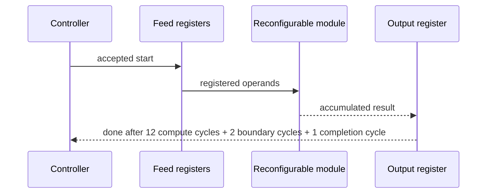
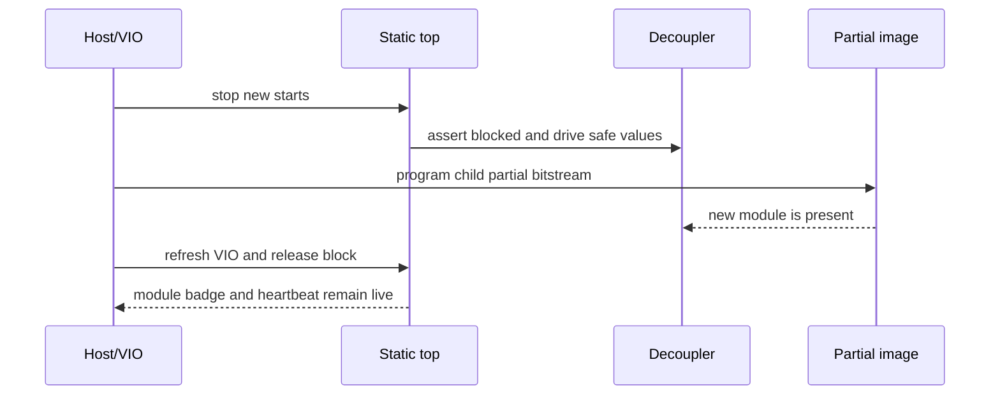
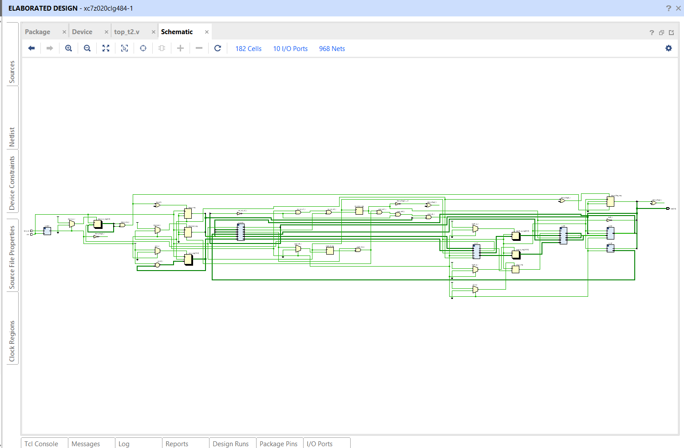
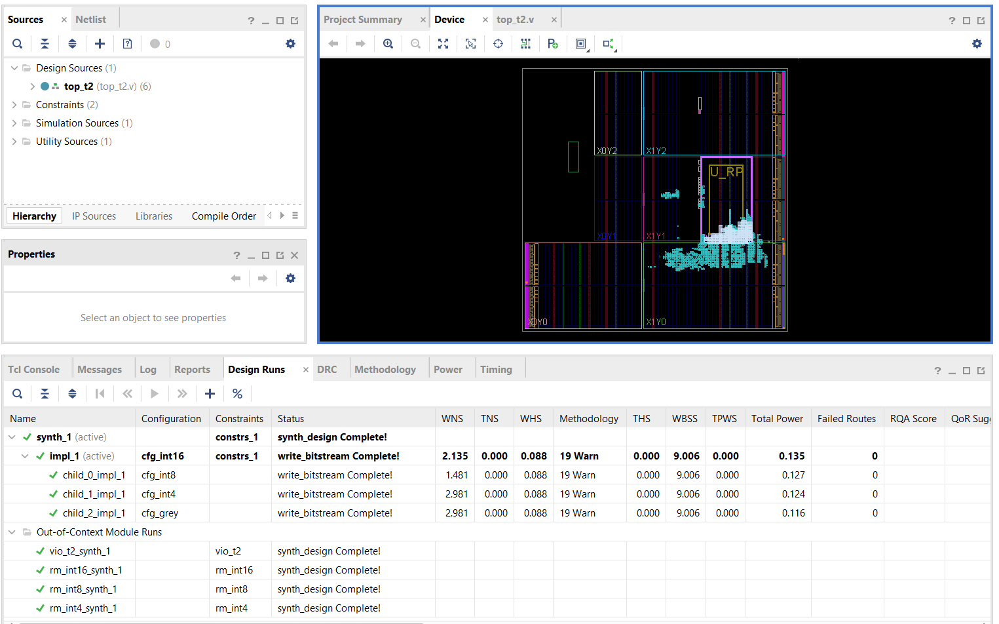
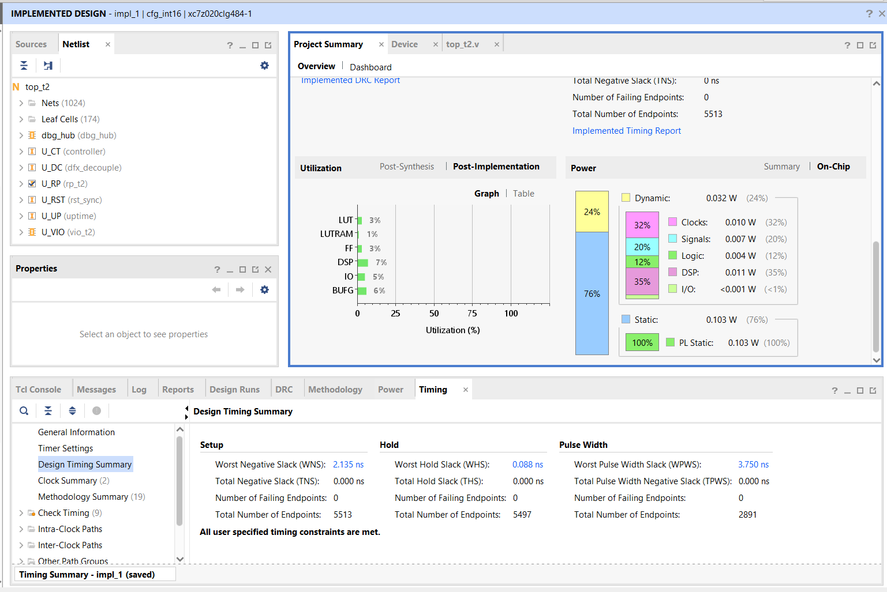

# T2 Complete Guide

**Dynamic Precision-Scalable Systolic Array using DFX**
Swapping the "number size" of a hardware calculator while it keeps running, on a ZedBoard FPGA.

*Who this is for:* someone smart who has never touched an FPGA. **Part I** (sections 1 to 11) explains T2 in plain language. **Part II** (sections 12 to 22) is the technical deep dive: design decisions, the hardware, verification, the Vivado build with its parent and child runs, the board session, the analysis and the lessons. Every technical word is explained the first time it appears. For the whole project (T0, T1, T2) see docs/PROJECT_DETAIL.md; for the live demo see docs/DEMO.md.

---

## 1. The one-minute version

- **What it is.** A small hardware calculator (a 4×4 grid, 16 tiny calculators) that multiplies tables of numbers (matrices). Matrix multiplication is the main workload of neural networks.
- **The trick.** The calculator can work with three "number sizes": 16-bit, 8-bit and 4-bit. Smaller numbers are less exact but cheaper. We can **swap between the three while the rest of the chip keeps running**, in about **0.43 seconds**.
- **How.** A Xilinx feature called Dynamic Function eXchange (DFX) lets us rewrite only one fenced-off region of the chip, not the whole thing.
- **Proof.** Every result the hardware produced matched a Python reference model exactly. 23 programming operations on the real board, no failures.
- **What we did not do.** No neural-network accuracy test, no power measurement. Those are future work (T3).

| Result | Value |
|---|---|
| Swap time between precisions (average of 12) | 0.43 s (full chip programming: 2.5 s) |
| Timing on a 100 MHz clock | met in all four builds (worst spare time +1.48 ns) |
| Board self-test | 14 of 14 steps passed, 58 of 58 checks |
| Live demo: same matrices on 16, 8 and 4 bits | 144 of 144 numbers matched the reference |
| Cost of 16-bit vs 8-bit vs 4-bit (lookup tables used) | 253 vs 1,451 vs 693 (16-bit uses 16 dedicated multipliers instead) |

---

## 2. The problem in everyday terms

A neural network is mostly one operation repeated billions of times: multiply two tables of numbers.

Numbers on a chip are stored with a fixed number of **bits** (binary digits). More bits means more precise but costs more chip area and energy. Think of measuring a table: a ruler with millimetre marks (16-bit) is more exact than one with centimetre marks (8-bit) or one with only 16 marks in total (4-bit). Sometimes "good enough" is fine and cheaper.

A normal chip design must pick one precision forever. We wanted the choice to be **changeable at run time**, without needing three separate calculators sitting on the chip.

---

## 3. The ideas you need

### 3.1 Matrix multiplication

Multiply row by column, add up the pieces:

```
A = | 1 2 |    B = | 5 6 |    C = A × B
    | 3 4 |        | 7 8 |

C[0][0] = 1×5 + 2×7 = 19      C[0][1] = 1×6 + 2×8 = 22
C[1][0] = 3×5 + 4×7 = 43      C[1][1] = 3×6 + 4×8 = 50
```

Each output needs a "multiply, then add to a running total" step. That step is called a **MAC** (multiply-accumulate).

### 3.2 The systolic array (an assembly line for MACs)

A **systolic array** is a grid of small calculators called **PEs** (processing elements). Each PE does one MAC per clock tick and passes its inputs to its neighbours, like buckets passed along a line.

Ours is **output-stationary**: PE(i, j) never moves its running total. It stays put and becomes output C[i][j]. Row values of A flow in from the west, column values of B from the north. Because neighbours get data one tick later, the inputs are fed in a **staircase**: row 1 starts one tick after row 0, row 2 one tick after that, and so on. That timing makes the right A and B values meet at the right PE. Our 4×4 grid has 16 PEs and finishes after 10 feed ticks.

### 3.3 Precision: what "int16, int8, int4" mean

"int" means whole number. The number is how many bits:

| Type | Range it can hold |
|---|---|
| int16 | −32,768 to 32,767 |
| int8 | −128 to 127 |
| int4 | −8 to 7 |

What if a value does not fit? Two options:

- **Saturate** (clamp to the limit): 200 in int8 becomes **127**. Like a thermometer that stops at its maximum.
- **Wrap** (keep only the low bits): 200 becomes **−56**. The sign flips, and the answer is silently wrong.

We always saturate.

### 3.4 Why the running total needs a bigger bucket

The sum of products is larger than the inputs. Worst case in int8: (−128) × (−128) = 16,384, and we add four of them = 65,536. That needs **18 bits** to store, not 8 or 17. For int4 the worst case is 4 × 64 = 256, which needs **10 bits**. For int16 the hardware uses 48 bits, and the final answer is clamped to 32 bits. (Rule of thumb: product bits double, plus 2 for adding four of them.)

### 3.5 Inside the FPGA: LUTs and DSPs

An **FPGA** is a chip full of reconfigurable logic. Two ingredients matter here:

- **LUT** (lookup table): a tiny programmable logic cell. You can build almost anything from thousands of them.
- **DSP slice**: a ready-made multiplier-adder baked into the chip. Fast and compact for 16-bit math.

Our int16 version uses 16 DSP slices (one per PE). Our int8 and int4 versions use **zero DSPs** and build their multipliers out of LUTs.

### 3.6 DFX: swapping part of the chip while the rest runs

Think of a house where you replace the furniture in one room while the rest of the house stays in use.

| House | Chip |
|---|---|
| The rest of the house | **Static region**: controller, debug link, LEDs, uptime counter. Never changes. |
| One fenced room | **Reconfigurable partition (RP)**, named `U_RP`, placed in a fenced area called a **Pblock** |
| The doorway, always the same size | **Frozen interface**: the same 180 wires cross the boundary for every module |
| Different furniture sets | **Reconfigurable modules (RMs)**: int16, int8, int4 |
| An empty room | **Greybox**: an RM that does nothing |
| New furniture delivery | **Partial bitstream**: a small file that rewrites only the fenced area |
| Closing the door during the move | **Decoupler**: forces the wires to safe values while the swap happens |

A **bitstream** is the file that configures an FPGA. A **full** bitstream rewrites everything (4.05 MB, 2.5 s). A **partial** one rewrites only the Pblock (0.59 MB, 0.43 s), and its size depends on the fenced area, not on what is inside.

---

## 4. What we built

```
  Laptop (Vivado) ──── JTAG cable ────▶ VIO debug core
                                         │ matrices A, B · start · pick-a-result
  ┌──────────────────────────────────────┴────────────────────────┐
  │  STATIC REGION (never reprogrammed in normal use)             │
  │   controller ─▶ feed registers ───────────┐                   │
  │   start gate · done flag                  │ 180 wires         │
  │   uptime counter · LEDs                   ▼                   │
  │                      ┌─────────────────────────────┐          │
  │                      │  SWAPPABLE REGION  U_RP     │          │
  │                      │  int16 │ int8 │ int4 │ empty│          │
  │                      └──────────────┬──────────────┘          │
  │   decoupler (the door) ◀────────────┘ results                 │
  └───────────────────────────────────────────────────────────────┘
```

- **Controller** (reused from the earlier tier T0) feeds the staircase of numbers.
- **Start gate:** a run is refused while the region is decoupled or held in reset. A `blocked` flag records any refused start.
- **VIO** (virtual input/output): a debug core that lets the laptop set switches and read values over the JTAG cable, no extra wiring needed.
- **Identity code:** each module reports an ID (16, 08 or 04; 00 for the empty one; FF while decoupled).
- **LEDs by design:** a blinking badge shows the loaded precision (four LEDs for int16, two for int8, one for int4) and a heartbeat LED proves the fixed part is alive.

### Timing of one calculation

The clock ticks 100 million times a second (10 ns per tick). The controller needs 12 ticks, plus 3 ticks for registers at the region boundary and the done flag: **15 ticks = 150 nanoseconds**, identical for every precision.

### How a swap works

1. Close the door (decouple). Results read as 0, the module ID reads FF, starts are refused.
2. Load the partial bitstream over JTAG (~0.43 s). The fixed part keeps running.
3. Re-open the door (release). The new module resets and reports its ID.
4. Load matrices, start, read results.

---

## 5. How we knew the answers were right

We wrote the maths twice: once in hardware, once in Python (the **golden model**). Every test compares the two exactly.

| Test case | What it catches |
|---|---|
| zeros, ones | Basic wiring |
| identity | Input clamping (multiplying by identity shows each value directly) |
| counting (1…16 and its transpose) | Row/column mix-ups |
| asym_small | Transposes that a symmetric test would hide |
| random_inrange | Ordinary arithmetic |
| random_full | Clamping at the array edge |
| extremes_neg, extremes_mix | Overflow and saturation |

The same files drive three checks: simulation, a pretend board, and the real board. Sample result for `counting`, element C[0][2] (row 0 of A times column 2 of B = 1×9 + 2×10 + 3×11 + 4×12): **110 in int16 and int8, but 70 in int4**, because int4 clamps every value above 7 down to 7.

We also ran **deliberately wrong builds** (the wrong module, a start gate forced open). Each one failed the tests, which proves the tests can detect mistakes. The board scripts were first rehearsed on a software mock of the board, which caught real bugs before the hardware was ever touched.

---

## 6. The build in Vivado

Vivado is Xilinx's design tool. We followed these stages:

1. **Create the project by script** (so it is exactly reproducible), with the fixed part plus three modules.
2. **Synthesis:** turn the Verilog code into LUTs and DSPs.
3. **Floorplan:** reuse the T1 fenced area in the right half of clock region **X1Y1**. That half contains DSP columns (the left half has none), so it can hold the int16 module. Capacity: 4,400 LUTs, 8,800 flip-flops, 40 DSPs, 10 block RAMs.
4. **Place and route** four configurations (int16, int8, int4, empty).
5. **Checks:** DRC (design-rule check) found 0 errors. `pr_verify` confirmed that all four builds have the identical fixed part, so any partial file fits any base design.

### Build results

| | int16 | int8 | int4 | empty |
|---|---|---|---|---|
| LUTs used by the swappable region | 253 | 1,451 | 693 | 179 |
| DSP slices | 16 | 0 | 0 | 0 |
| Share of the fenced area's LUTs | 5.75% | 32.98% | 15.75% | 4.07% |
| Worst setup slack (ns) | +2.135 | +1.481 | +2.981 | +2.981 |
| Worst hold slack (ns) | +0.088 | +0.088 | +0.088 | +0.088 |

**Reading the table:**
- **Slack** is spare time. A signal has 10 ns per tick; slack is how much is left on the slowest path. Positive means the timing is met. **Hold** slack checks that data does not change too early.
- The identical hold slack in all four builds is expected: the fixed part is locked and shared.
- The fixed part uses 1,300 LUTs and 2,659 flip-flops in every build (total minus the swappable region).
- The empty module still shows 179 LUTs, equal to the number of region wires (a likely interface cost; not yet confirmed in the reports).
- int4 is about 2.1 times smaller than int8 in LUTs, not 4 times: the adders, accumulators and control around the multipliers do not shrink with the number size.

Bitstream sizes: partial 585,559 bytes, full 4,045,666 bytes. (We predicted one byte more for each; the header text differs by a character. Likely cause, not confirmed.)

---

## 7. On the real board (22 October 2026)

Setup: ZedBoard, Vivado Hardware Manager, **JTAG clock 15 MHz**. A script (`hw_t2.tcl`) drives the board: it programs the files, writes matrices into the VIO, starts runs and reads results back.

What happened:

- Programmed the full int16 design, checked all 9 test cases: **9 of 9**. Swapped to int8, all 9: **9 of 9**.
- Start-gating test: starts were **refused** while decoupled and while the module was held in reset, and accepted after release.
- Live demo (same matrices through int16, int8, int4, int16): **144 of 144** numbers matched. For `counting`, int8 equals int16 but int4 differs in 15 of 16 elements. For `extremes_neg`, every element reads 2,147,483,647 (saturated, with overflow flag) in int16, 65,536 in int8, and 256 in int4.
- Self-test: 2 full programs and 12 swaps (int8, int4, empty, int16, three times). **14 of 14 steps passed.** The fixed part's uptime counter ran from 2 to 29 seconds without ever going backwards, so it was never disturbed. It reset only on the full re-programming, as designed.
- Total: **23 programming operations (19 partial, 4 full), none failed.**

Swap time: average **0.43 s** (range 0.41–0.52 s). It is the same for every module because the partial file has the same size.

**One prediction missed.** We expected about 1.4 s per swap. The measured 0.43 s is faster because this session's JTAG cable ran at 15 MHz, while the earlier T1 clock speed was not recorded. The effective speed was about 11 Mbit/s.

---

## 8. What this shows, and what it does not

**Shows**
- One fenced chip region can host three precision variants behind one frozen interface.
- Each variant matched the reference model bit for bit.
- Swapping takes under half a second and leaves the rest of the design running.
- Smaller precision trades accuracy for logic: the DSP-free modules cost 693 to 1,451 LUTs, while int16 costs 16 DSPs and 253 LUTs.

**Does not show**
- Neural-network accuracy (no MNIST or other workload was run).
- Power or energy (not measured).
- A full 9-case test of int4 on the board. int4 passed 5 case types in the self-test and 3 in the demo. The other four (identity, ones, zeros, random_inrange) passed in simulation only.
- LED behaviour in the log (designed and simulated, not recorded).
- Anything beyond one board, one JTAG speed and 12 timed swaps.

---

## 9. What comes next (T3 ideas, not started)

- Convert real-valued data to 16/8/4-bit integers on the host, run through each precision, and **measure the error against int16**.
- Try a small real workload, and measure power.
- Close the int4 on-board test gap and photograph the LEDs.
- Explore larger arrays or more modules in the same region, and faster reconfiguration.

---

## 10. Glossary

| Term | Meaning |
|---|---|
| Accumulator | The running total inside a PE |
| Bit | One binary digit; n bits hold 2ⁿ values |
| Bitstream | File that configures the FPGA (full or partial) |
| Clock | The tick (100 MHz here) that paces the logic |
| DFX | Dynamic Function eXchange: reconfiguring part of an FPGA at run time |
| Decoupler | Logic that forces boundary wires to safe values during a swap |
| DRC | Design-rule check |
| DSP slice | Built-in multiplier-adder block |
| FPGA | Chip whose logic can be rewired by loading a file |
| Golden model | Trusted Python reference used to check hardware |
| Greybox | Empty module used as a blank or baseline |
| JTAG | Cable interface used to program and debug the chip |
| LUT | Small programmable logic cell |
| MAC | Multiply-accumulate step |
| Output-stationary | Each PE keeps one output's running total |
| Partition pin | A wire crossing the region boundary (180 here) |
| Pblock | The fenced physical area for the swappable region |
| PE | Processing element, one tile of the array |
| `pr_verify` | Vivado check that builds share an identical fixed part |
| RM / RP | Reconfigurable module / reconfigurable partition |
| Saturation | Clamping a value to the largest or smallest allowed |
| Slack | Spare time on a signal path (setup or hold) |
| Static region | The part of the chip that is never swapped |
| Systolic array | Grid of PEs passing data between neighbours |
| VIO | Debug core giving virtual switches and displays over JTAG |

---

## 11. Where the numbers come from

| Topic | File |
|---|---|
| Timing, resources, pin count, DRC | `docs/t2/reports/build_summary.csv` |
| Compatibility check | `docs/t2/reports/pr_verify.rpt` |
| Simulation cycles and results | `docs/t2/reports/sim_cycles.csv`, `sim_summary.txt` |
| Bitstream sizes | `bitstreams/t2/manifest.csv` |
| Board session log | `docs/t2/reports/hw_session_20261022.log` |
| Self-test and demo data | `docs/t2/reports/hw_selftest_20261022_134926.csv`, `hw_demo_20261022_134038.csv` |
| Session summary and predictions | `docs/t2/T2_BOARD_RUNBOOK.md` (section F) |
| Design decisions and names | `docs/t2/T2_PLAN.md` |

---

## 12. Part II: the technical deep dive

Part I described the result in plain language. Part II follows the same T2 build from its frozen interface to the board evidence. T0 established the 4x4 int16 systolic array. T1 established the Dynamic Function eXchange (DFX) boundary and proved that a reconfigurable module could be swapped while the static design continued. T2 keeps that boundary and places int16, int8, int4, and greybox variants behind it.

The sections are ordered like the engineering work: decisions, architecture, RTL, reference model, verification, Vivado implementation, board operation, analysis, lessons, and reproduction. Tables use the names from reports and scripts. A number is a measured result only where a report, CSV, log, or plan records it.

The wider project history and the T0/T1 context are collected in `docs/PROJECT_DETAIL.md`. The live demonstration procedure is in `docs/DEMO.md`.

Part II treats a module as a replaceable calculator. The static top owns clocks, control, safety, and the board interface. The reconfigurable module owns only the arithmetic that changes. This split is why the bitstream can be partial and why the outside signals remain stable during a swap.

*Sources: docs/PROJECT_DETAIL.md, docs/t2/T2_PLAN.md, docs/DEMO.md*

## 13. The design decisions

| Decision | Reason | Consequence |
|---|---|---|
| D1: reuse the T1 partition | T1 already proved the fence and static continuity | T2 inherits a known floorplan |
| D2: freeze the interface | the static top must survive every module swap | all modules use the same 180 pins |
| D3: keep DSP arithmetic for int16 | the device has dedicated multiply resources | int16 is compact in LUTs but uses 16 DSPs |
| D4: use LUT multipliers for int8 and int4 | smaller lanes can be packed into configurable logic | int8 and int4 trade DSPs for LUTs |
| D5: clamp lane inputs | signed values must stay within the selected precision | overflow behavior is deterministic |
| D6: register both sides of the boundary | registers make the DFX contract explicit | the boundary costs two cycles |
| D7: reuse the controller | the feed schedule does not depend on precision | every module has the same timing |
| D8: keep output-stationary accumulation | each processing element retains one result | the readout is simple and ordered |
| D9: expose a greybox | build and board checks need a harmless replacement | configuration can be tested without arithmetic |
| D10: use one probes file | the static VIO names do not change | every full and partial image uses t2_full_int16.ltx |
| D11: validate in layers | a failed board test is expensive to diagnose | Python, simulation, synthesis, implementation, mock, and board checks agree |

D1 is a capacity decision as well as a history decision. The frozen interface has about 180 signals because it carries 134 inputs, 45 outputs, and a clock. A new boundary with roughly 900 wires would consume more routing and make the static contract harder to inspect. Reusing the T1 Pblock keeps the physical proof and changes only the module logic.

D3 separates the DSP processing element from the LUT processing element. The int16 module uses the device's dedicated DSP multiply resources. The LUT PE is the int8/int4-style implementation whose multiplier is explicitly constrained with `use_dsp = "no"`; this keeps that implementation in configurable logic. The consequence is visible in the resource table: DSP usage is 16, 0, 0, and 0 for int16, int8, int4, and greybox.

D6 puts a register immediately before and immediately after the reconfigurable region. That costs two cycles, but it gives the static design a stable timing boundary and makes the safe value during decoupling explicit. It is a small, fixed cost compared with making each precision variant negotiate a different protocol.

The accumulator widths are 48 bits for int16, 18 bits for int8, and 10 bits for int4. The latter two are 18 and 10, not 17 and 9: a signed product needs twice the operand width, and summing four products needs two more signed growth bits. Thus 2*8+2 = 18 and 2*4+2 = 10.

*Sources: docs/t2/T2_PLAN.md, docs/t1/T1_Complete_Guide.md, rtl/t2/rm/rm_int16.v, rtl/t2/rm/rm_int8.v, rtl/t2/rm/rm_int4.v*

## 14. The architecture in detail

The static top instantiates the controller, feed registers, the reconfigurable partition, the decoupler, uptime counter, heartbeat, and VIO-facing status. The controller reuses the T0 feed schedule. The start gate blocks a new operation while the `blocked` flag is asserted and increments the runs counter only for an accepted start. The done flag is a registered completion indication.

The decoupler is 45 bits wide. During a swap it drives its safe value instead of allowing changing signals to cross the boundary. Uptime and heartbeat provide a visible static-region liveness signal. The LED map reports reset, busy, done, blocked, overflow, and the selected module badge. Module IDs distinguish int16, int8, int4, and greybox.

| Port group | Width | Direction | Meaning |
|---|---:|---|---|
| clock and reset | 2 | in | board clock and reset control |
| matrix input lanes | 128 | in | packed A and B values for the four-by-four operation |
| start and control | 4 | in | start, mode, and VIO control signals |
| static status | 2 | out | done and overflow |
| matrix result | 32 | out | selected signed result word |
| module badge | 4 | out | active reconfigurable module ID |
| safety and counters | 7 | out | blocked, heartbeat, uptime and run status |

The frozen contract is 134 inputs, 45 outputs, and one clock: 180 partition pins in total. The exact names and widths are read from the RM module ports, not inferred from the board display.



The latency budget is CT_CYCLES 12 plus two boundary cycles plus one completion cycle, so start-to-done is 15 cycles for every module.





*Caption: RTL schematic exported from Vivado.*

*Sources: rtl/t2/top_t2.v, rtl/t2/rm/rm_int16.v, rtl/t2/rm/rm_int8.v, rtl/t2/rm/rm_int4.v, rtl/t2/rm/rm_grey.v, rtl/t2/dfx_decouple.v, docs/t2/T2_PLAN.md*

## 15. The hardware, module by module

| Module | Arithmetic | Accumulator | DSP use | Purpose |
|---|---|---:|---:|---|
| int16 | signed 16-bit multiply | 48 bits | 16 | highest precision reference path |
| int8 | signed 8-bit multiply | 18 bits | 0 | smaller LUT-based path |
| int4 | signed 4-bit multiply | 10 bits | 0 | smallest arithmetic path |
| greybox | protected constants | none | 0 | safe configuration and routing check |

The array is a four-by-four mesh of processing elements. Each PE receives a value from the left and a value from above, multiplies them, adds the product to its stationary accumulator, and forwards the operands to its neighbors. The controller supplies the staircase feed so that corresponding operands meet at the correct cycle.

The LUT PE clamps each input lane before multiplication. This is different from merely truncating the final result: the selected precision is enforced at the lane boundary, so every module sees a defined signed operand. The readout then clamps the selected result to 32 bits. The int16 path can instead sign-extend its narrower internal view when the value is already in range.

The greybox and badge logic drive constant outputs through protected registers. A constant registered output is safer across configuration because it does not depend on an uninitialized combinational cone during the interval in which the reconfigurable region is being replaced. The badge gives the host a simple proof of which module is loaded.

The following short excerpt shows the input clamp shape used by the LUT-oriented arithmetic. It is intentionally small: the point is the signed boundary, not a retyped implementation.

```verilog
// Input values are narrowed before the multiply mesh sees them.
always_comb begin
  lane_a = clamp_signed(a_in, PRECISION);
  lane_b = clamp_signed(b_in, PRECISION);
end
```

Caption: lane-clamp logic in the LUT processing-element source.

A second boundary register holds the selected result before it crosses into the static readout. This is the hardware reason the interface costs two cycles and why a partial image can be swapped without changing the static port list.

*Sources: rtl/t2/top_t2.v, rtl/t2/rm/rm_int16.v, rtl/t2/rm/rm_int8.v, rtl/t2/rm/rm_int4.v, rtl/t2/rm/rm_grey.v, docs/t2/T2_PLAN.md*

## 16. The reference model and the test cases

The Python golden model computes the same output-stationary operation as the RTL: signed operands are interpreted at the selected precision, products are accumulated in the selected accumulator width, and the final values are compared with the expected matrix. The model is the reference for simulation vectors, the mock board, and the real-board answer files.

| Case | What it catches |
|---|---|
| zeros | reset and all-zero propagation |
| ones | basic accumulation |
| identity | row/column routing |
| counting | feed order and hand-checkable values |
| random | ordinary signed arithmetic |
| extremes | saturation and sign boundaries |
| alternating | sign changes and lane timing |
| impulse | one active operand path |
| asymmetric | transposition and operand-order mistakes |

The board probe string is a 64-hex-digit representation of the packed 16-element answer matrix. A[3][3] is placed first in the packing order, followed by the remaining elements in the defined reverse traversal. The host and Tcl scripts use the same order, so a displayed probe value can be compared directly with a generated answer file.

For the counting vectors, the 4x4 result is the same mathematical matrix when the values fit the selected precision. The int16, int8, and int4 cases therefore provide a useful routing check, while the extreme cases expose the intentional precision differences. The expected values are generated once and then consumed by Python, simulation, the board mock, and the board script.

That shared answer-file path matters. It prevents the simulator, mock harness, and board procedure from quietly using different packing conventions. A mismatch is either an arithmetic mismatch or a transport/packing mismatch, rather than an ambiguous mixture of both.

*Sources: python/golden_t2.py, python/gen_vectors_t2.py, python/test_golden_t2.py, scripts/t2/hw_t2.tcl, scripts/t2/hw_t2_mock.tcl, sim/t2_vectors, docs/t2/T2_PLAN.md*

## 17. Verification before Vivado

Verification is layered so that a board failure has a small search area. The RP bench checks a reconfigurable module in isolation. The top bench checks the static wrapper, VIO stub, decoupler, and status signals together. The six positive builds cover the supported arithmetic configurations and their expected interfaces. Three negative builds deliberately violate the contract; `sim_summary.txt` records the reason each one fails.

The project uses XSim for the T2 top-level checks. Icarus Verilog 0.9.7 rejects T0's two-dimensional net arrays, so XSim is the simulator used for this stage. That is a tool limitation, not a change to the arithmetic reference.

| Out-of-context gate | LUT | FF | Result |
|---|---:|---:|---|
| int16 | 254 | recorded in report | pass |
| int8 | 1,442 | recorded in report | pass |
| int4 | 597 | recorded in report | pass |

The in-project int4 synthesis reports 674 LUTs, which is a different measurement from the out-of-context gate because the project wrapper and implementation context are included. The OOC checks are gates on the module contract; they are not substitutes for the full implementation reports.

The scratch-project validation confirms that the project is project-ready and that the scratch build is OK. The Tcl project script then becomes the reproducible bridge from source files to the Vivado project rather than relying on a hidden GUI state.

The simulation summary also records the negative cases. Each negative build is useful because it proves that the test harness can detect a wrong module shape, an invalid timing/configuration assumption, or a deliberately malformed connection. Passing only positive tests would not establish that the contract is enforced.

*Sources: docs/t2/reports/sim_summary.txt, docs/t2/reports/ooc_summary.csv, docs/t2/reports/scratch_validation.log, scripts/t2/run_sims.py, scripts/t2/ooc_check.tcl, tb/t2/tb_rp_t2.v, tb/t2/tb_top_t2.v*

## 18. The Vivado flow and the child runs

### 18.1 Creating the project by script

`create_project_t2.tcl` replaces a long sequence of GUI actions. It creates the project for `xc7z020clg484-1`, adds RTL and constraints, defines the static top and reconfigurable partition, adds the module filesets, and creates the synthesis and implementation runs. In the GUI these actions correspond to creating a project, adding sources, adding constraints, defining the DFX configuration, and launching runs. The script makes the order visible and repeatable.

### 18.2 The floorplan

The Zynq-7000 fabric is divided into clock regions. T2 uses the right part of clock region X1Y1. A configuration column at RPM_X 205 splits the region; the left side does not provide the DSP column needed by the int16 implementation, while the chosen side contains the two relevant DSP columns and nearby block RAM sites. That is why the fence is a physical resource decision, not just a rectangle drawn for convenience.

The Pblock ranges are:

```tcl
resize_pblock [get_pblocks pblock_U_RP] -add {SLICE_X80Y50:SLICE_X103Y99}
resize_pblock [get_pblocks pblock_U_RP] -add {DSP48_X3Y20:DSP48_X4Y39}
resize_pblock [get_pblocks pblock_U_RP] -add {RAMB18_X4Y20:RAMB18_X4Y39}
resize_pblock [get_pblocks pblock_U_RP] -add {RAMB36_X4Y10:RAMB36_X4Y19}
set_property CLOCKREGION X1Y1 [get_pblocks pblock_U_RP]
```

Block RAM is listed by site-name ranges because those are the physical resources Vivado places, while the clock-region label describes the larger timing and clocking neighborhood. The T2 checks query `get_property GRID_RANGES` on the Pblock, use `get_cells -of_objects` to inspect what is inside it, and run `report_drc`.

T2 reused the T1 Pblock because T1 had already proved the DFX boundary and static behavior. The region has enough capacity for the T2 module resources: the largest module uses 1,451 LUTs, while the region has 4,400 LUTs available in the earlier T1 accounting. Reuse is safe here because the T2 module needs remain inside the established fence and the static interface is frozen.

### 18.3 Synthesis

The five synthesis configurations are the static parent plus the int16, int8, int4, and greybox module configurations. Each module is synthesized with the same interface. The parent establishes the static design; each child configuration supplies one implementation of the replaceable logic.

*Sources: scripts/t2/create_project_t2.tcl, constraints/top_t2_pblock.xdc, docs/t1/T1_Complete_Guide.md, docs/t2/T2_PLAN.md, docs/t2/reports/cfg_int16_timing_summary.rpt*

### 18.4 Parent and child implementation runs

The parent run implements the whole design and locks the static routing. A child run reuses that locked static part and implements only its reconfigurable module. Because the static work is shared, the child implementations can run in parallel after the parent checkpoint exists.

| Run | Configuration | Module | Main files produced |
|---|---|---|---|
| impl_1 | cfg_int16 | int16 | top_t2.bit, routed checkpoint |
| child_0_impl_1 | cfg_int8 | int8 | partial bitstream, routed checkpoint |
| child_1_impl_1 | cfg_int4 | int4 | partial bitstream, routed checkpoint |
| child_2_impl_1 | cfg_grey | greybox | partial bitstream, routed checkpoint |



*Caption: Vivado design runs, parent and child implementation runs.*



*Caption: Vivado implementation result.*

### 18.5 Results

| Configuration | WNS (ns) | WHS (ns) | LUT | FF | DSP |
|---|---:|---:|---:|---:|---:|
| int16 | 2.135 | 0.088 | 253 | 166 | 16 |
| int8 | 1.481 | 0.088 | 1,451 | 600 | 0 |
| int4 | 2.981 | 0.088 | 693 | 336 | 0 |
| greybox | 2.981 | 0.088 | 179 | 1 | 0 |

WNS is worst negative slack, the timing margin for setup. A positive value means the path meets the 100 MHz requirement with that much margin. WHS is worst hold slack. It is identical in all four builds because the static clocking and boundary timing are shared. The static region is 1,300 LUTs and 2,659 FFs in every build when calculated as total design resources minus the module region resources.

The timing reports identify the worst setup path for each configuration by its start point, end point, logic levels, and slack. The report values are the authority for those path details; the summary table above preserves the four WNS values. DRC reports 0 errors, and `pr_verify.rpt` reports a passing partial-reconfiguration verification.

### 18.6 Collecting the bitstreams

The collection script has a staleness guard: it checks that the source run artifacts belong to the current build before copying them into `bitstreams/t2`. The manifest records each collected file, byte count, checksum, and source run. The full image is 4,045,666 bytes and a partial image is 585,559 bytes; the plan's earlier predictions were 4,045,667 and 585,560 bytes.

The bundle check verifies that the manifest, full images, partial images, and probes file are present and consistent. Every programming step uses `t2_full_int16.ltx` because the VIO probes are static and the frozen interface does not change when the arithmetic module changes.

*Sources: scripts/t2/collect_bitstreams.py, scripts/t2/verify_bundle.py, scripts/t2/reports_t2.tcl, docs/t2/reports/build_summary.csv, docs/t2/reports/pr_verify.rpt, docs/t2/reports/cfg_int16_timing_summary.rpt, bitstreams/t2/manifest.csv*

## 19. The board session (2026-10-22)

### 19.1 Setup and Tcl commands

| Command | What it does | Vivado operation underneath |
|---|---|---|
| `t2_connect` | connect to the ZedBoard | `open_hw_manager`, `connect_hw_server`, `open_hw_target` |
| `t2_program full int16` | load the full static image | set `PROGRAM.FILE`, set `PROBES.FILE`, `program_hw_devices` |
| `t2_probes` | resolve the VIO probes | `get_hw_vios`, `get_hw_probes` |
| `t2_check ones` | write inputs and read one answer | `set_property OUTPUT_VALUE`, `commit_hw_vio`, `refresh_hw_vio`, `get_property INPUT_VALUE` |
| `t2_swap_demo int8` | decouple and load a partial image | set decouple, program the partial, refresh the device |
| `t2_status` | read badge, uptime, and counters | refresh VIO and read `INPUT_VALUE` |

The script uses a 15,000,000 Hz JTAG clock. The runbook's session sheet records the connection, the full int16 image, probe resolution, checks, swaps, demo, and self-test in that order.

### 19.2 Session sequence

The recorded sequence first loaded full int16, resolved all 11 probes, and checked the simple ones case. It then ran the int16 and int8 checks, tested start gating, ran the three-precision demo, loaded greybox and int16, ran a full-program contrast, and finished with the 14-step self-test. The int4 swap and board-wide int4 case sweep were not part of the recorded live session; the CSV and limits section preserve that distinction.

### 19.3 Demo result

The demo CSV contains 144 rows and 0 mismatches. It compares hardware and golden values across the recorded precision configurations. It is evidence for the displayed demo rows, not a claim that every possible int4 input was tested on the board.

### 19.4 Self-test CSV

| Step | Operation | ms | Uptime before -> after | ID | Cases | Verdict |
|---:|---|---:|---|---|---:|---|
| 1 | full int16 | 2504 | - -> 2 | 16 | 5/5 | PASS |
| 2 | full int16 | 2497 | 3 -> 0 | 16 | 5/5 | PASS |
| 3 | partial int8 | 421 | 2 -> 3 | 08 | 5/5 | PASS |
| 4 | partial int4 | 436 | 5 -> 6 | 04 | 5/5 | PASS |
| 5 | partial grey | 415 | 7 -> 8 | 00 | 1/1 | PASS |
| 6 | partial int16 | 419 | 9 -> 10 | 16 | 5/5 | PASS |
| 7 | partial int8 | 418 | 12 -> 12 | 08 | 5/5 | PASS |
| 8 | partial int4 | 436 | 14 -> 15 | 04 | 5/5 | PASS |
| 9 | partial grey | 416 | 17 -> 18 | 00 | 1/1 | PASS |
| 10 | partial int16 | 414 | 18 -> 19 | 16 | 5/5 | PASS |
| 11 | partial int8 | 518 | 21 -> 22 | 08 | 5/5 | PASS |
| 12 | partial int4 | 427 | 24 -> 25 | 04 | 5/5 | PASS |
| 13 | partial grey | 421 | 27 -> 28 | 00 | 1/1 | PASS |
| 14 | partial int16 | 411 | 28 -> 29 | 16 | 5/5 | PASS |

This is 14/14 steps and 58/58 case checks. The partial mean is 429.3 ms (N = 12, standard deviation 29.1 ms, minimum 411 ms, maximum 518 ms). The two full programs have mean 2,500.5 ms.

### 19.5 Start gating and file order

The start-gating test refuses a start while the region is decoupled or blocked. A full int16 image is loaded first because it supplies the static design and the probes. The partial images then come from the child runs: int8, int4, greybox, and int16. The probe file remains `t2_full_int16.ltx` for every programming step.

### 19.6 Mock and warning

The software mock simulates connection, programming, VIO reads/writes, decoupling, module IDs, timing, answer checks, and uptime. It contains 17 positive checks and five deliberate faults, each paired with the check that should catch it. The harmless Labtools 27-1952 warning concerns a VIO value cache refresh; it is not evidence of arithmetic failure. The LED behavior belongs to `docs/DEMO.md`, not to the hardware log.

*Sources: scripts/t2/hw_t2.tcl, scripts/t2/hw_t2_mock.tcl, docs/t2/T2_BOARD_RUNBOOK.md, docs/t2/reports/hw_session_20261022.log, docs/t2/reports/hw_selftest_20261022_134926.csv, docs/t2/reports/hw_demo_20261022_134038.csv*

## 20. What the numbers mean

| Module | LUT | DSP | What the trade means |
|---|---:|---:|---|
| int16 | 253 | 16 | dedicated multipliers keep LUT use low |
| int8 | 1,451 | 0 | LUT multipliers cost configurable logic |
| int4 | 693 | 0 | narrower LUT arithmetic is smaller, but not one quarter of int8 |
| greybox | 179 | 0 | protected constants and interface logic only |

Int4 is about 2.1 times smaller than int8 in the reported module LUT values, not four times smaller. The implementation still includes the same array shape, clamps, registers, readout, and control; only the arithmetic width shrinks. Width is therefore not the only contributor to area.

The 12 partial swaps average 429.3 ms at a 15 MHz JTAG clock. The effective transfer rate is approximately 585,559 bytes divided by the measured time, about 1.1 MB/s. A two-point fit from the recorded data is 0.599 microseconds per byte plus 0.079 s. T1's fit was 2.21 microseconds per byte plus 0.13 s, so T2's measured transfer behavior is faster in this session. The swap time does not depend on precision because each partial image rewrites the same Pblock frame set.

The greybox's 179 LUTs are a small but useful observation: they suggest that most of the module area in the arithmetic variants belongs to the multiplier/accumulator logic rather than the frozen interface. A dedicated report isolating every wrapper contribution would confirm that interpretation.

The continuity check is weak when programs finish in less than a second because a one-second uptime sample can miss a short interruption. The monotonic uptime sequence from 2 to 29 seconds across the self-test is stronger evidence: the static counter continued across the partial swaps, while the full-program row reset it.

| Prediction | Measured outcome |
|---|---|
| P1: every partial 585,560 B | 585,559 B |
| P2: every full 4,045,667 B | 4,045,666 B |
| P3: swap about 1.42 s | 429.3 ms mean for the 12 recorded partials |
| P4: DSP 16/0/0/0 | measured 16/0/0/0 |
| P5: int8 LUT larger than int4 | measured 1,451 versus 693 |
| P6: equal compute latency | CT_CYCLES 12 and start-to-done 15 for every module |
| P7: static resources above T1 | T2 VIO/status interface is larger |
| P8: timing meets 100 MHz | WNS is positive in all four builds |
| P9: board matches `c_out.hex` | demo has 144 rows and 0 mismatches; the recorded board sweep has stated limits |

*Sources: docs/t2/T2_PLAN.md, docs/t2/reports/build_summary.csv, docs/t2/reports/hw_selftest_20261022_134926.csv, docs/t2/reports/cfg_int16_timing_summary.rpt, docs/t2/reports/cfg_int8_timing_summary.rpt, docs/t2/reports/cfg_int4_timing_summary.rpt, docs/t2/reports/cfg_grey_timing_summary.rpt*

## 21. Bugs, deviations and lessons

The as-built record is a compact history of decisions that became rules:

| Event | Symptom | Cause or fix | Lesson |
|---|---|---|---|
| A1-1 | full T0 array would not lint in old Icarus | XSim ran the complete benches; Icarus remained compile-only where possible | pin the simulator version and scope |
| A1-2 | controller had an extra `running` output | it was wired to unused `ct_running` | inspect reused RTL ports before freezing the interface |
| A1-3 | quantisation helper choice was uncertain | `saturate` and `clip_to_width` matched the full-range clamp sweep | test helper equivalence rather than guessing |
| A1-4 | hex width differed for 10/18-bit values | `golden_t2.to_hex` uses ceiling nibble width | keep exact-width and probe-width formats separate |
| A1-5 | probe names could differ after synthesis | the script accepts the locked static names and known aliases | preserve RTL net names |
| A1-6 | constant outputs were optimized | internal `dont_touch` registers drive output wires | keep partition pins flop-driven |
| A1-7 | two-dimensional net arrays failed old Icarus | the LUT array uses flat buses | use a lint-compatible representation |
| A1-8 | Git Bash Vivado launch failed | PowerShell found Vivado's Tcl helpers | launch Vivado batch from PowerShell or cmd |
| A1-9 | shared RM files moved unexpectedly | the fileset script assigns them after `-define_from` | assert fileset membership |
| A1-10 | a stray argument could redirect a build | project path is accepted only as an absolute path | validate command-line paths |
| A1-11 | cleanup risked read-only generated folders | the T1 cache was retained | obey repository boundaries |
| A1-12 | T1 command syntax was easy to misremember | the T1 journal supplied the DFX forms | read the known-good journal |

The later gotchas are operational rules. G16 fixes the accumulator widths at 18 and 10 bits. G17 requires `random_full` and `extremes_*`, because small vectors can make every precision look identical. G18 fixes the 256-bit probe ordering: the first hex digit is bit 255 and represents the top nibble of A[3][3]; the last four digits are A[0][0]. G19 forbids sending `08` or `04` through Tcl `expr`; format hexadecimal strings directly and sign-convert 32-bit results explicitly.

G20 keeps int8/int4 constant outputs and sign-extension bits on `dont_touch` flops. G21 keeps one authoritative RM file list. G22 freezes RTL, constraints, and filesets during a build. G23 separates GUI builds from scratch batch work. G24 refuses a bitstream outside the T2 manifest. G25 reruns a case after decoupling so stale `done_flag` data is not read.

G26 scopes XSim to the named bench and records the old Icarus limitation. G27 preserves probe net names. G28 records the Git Bash Vivado failure. G29 explains why opening the synthesized checkpoint alone can show a VIO black-box warning while the RP check remains meaningful.

The board-script mock caught a hex string passed through Tcl `expr`: `00007E45` became a floating-point number. It also caught a bracket error in a format string before hardware was touched. XSim replaced Icarus 0.9.7 for the two-dimensional T0 array. Vivado batch jobs fail from Git Bash but work from PowerShell. The T1 log was lost to copy-paste, so T2 was logged with `vivado -log`. A visual Markdown editor rewrote tables and code blocks on save; these documents are therefore edited as plain text.

*Sources: docs/t2/T2_PLAN.md, docs/t2/reports/scratch_validation.log, scripts/t2/hw_t2_mock.tcl, scripts/t2/hw_t2.tcl*

## 22. Limits, next steps and how to reproduce

### 22.1 Limits

The board evidence does not include a complete nine-case int4 sweep. The four missing board cases are the int4 `random_full` and `extremes_*` cases identified by the plan. The demo has 144 rows and 0 mismatches, but that is not the same as exhaustive int4 coverage. LED observations are not recorded in the hardware log; use `docs/DEMO.md` for the filmed LED behavior. No T2 power figure, workload accuracy figure, or multi-board result was recorded in the repo. The timing evidence is for the 100 MHz target. The timing dataset contains 12 timed partial swaps at one JTAG clock.

T3 ideas are not started: host-side quantisation, error versus int16, workload experiments, and power measurement. They are next steps, not completed results.

### 22.2 Reproduce T2 from a clean clone

1. Install the documented Python dependencies and run the golden-model checks.
2. Generate the T2 vectors and run the simulator benches. The expected result is the recorded all-pass simulation summary.
3. Run the out-of-context synthesis check and confirm the OOC summary.
4. Run `create_project_t2.tcl` to create the Vivado project and DFX configurations.
5. Open the project in Vivado, inspect the Pblock, synthesize the parent and child configurations, and run implementation at 100 MHz.
6. Run the reports script, then `collect_bitstreams.py` with the staleness guard.
7. Run the mock board script and confirm its positive checks and deliberate-fault checks.
8. Run `verify_bundle.py` and confirm `BUNDLE OK`.
9. On the board, connect at 15,000,000 Hz, load full int16 with `t2_full_int16.ltx`, resolve probes, run checks, perform the permitted swaps, and save the session CSV.

Vivado GUI steps are deliberately kept in the reproduction sequence because the human operator performs the board and GUI actions. No batch command substitutes for the physical board evidence.

### 22.3 T2 file map

| Area | Files |
|---|---|
| RTL | `rtl/t2/top_t2.v`, `rtl/t2/rm/*.v`, static controller and decoupler sources |
| Constraints | `constraints/top_t2.xdc`, `constraints/top_t2_pblock.xdc` |
| Simulation | `tb/t2/*`, `sim/t2_vectors/*` |
| Python | `python/golden_t2.py`, `python/gen_vectors_t2.py`, `python/test_golden_t2.py` |
| Build scripts | `scripts/t2/create_project_t2.tcl`, `t2_filesets.tcl`, `ooc_check.tcl`, `reports_t2.tcl` |
| Board scripts | `scripts/t2/hw_t2.tcl`, `hw_t2_mock.tcl`, `verify_bundle.py` |
| Evidence | `docs/t2/reports/*`, `bitstreams/t2/manifest.csv` |
| Images | `docs/t2/img/rtl_schematic.png`, `Child_runs_impl.png`, `impl.png` |
| Documents | `docs/t2/T2_PLAN.md`, `T2_BOARD_RUNBOOK.md`, `docs/DEMO.md`, `docs/PROJECT_DETAIL.md` |

*Sources: docs/t2/T2_PLAN.md, docs/t2/T2_BOARD_RUNBOOK.md, docs/DEMO.md, docs/PROJECT_DETAIL.md, scripts/t2/create_project_t2.tcl, scripts/t2/hw_t2.tcl, scripts/t2/verify_bundle.py*
