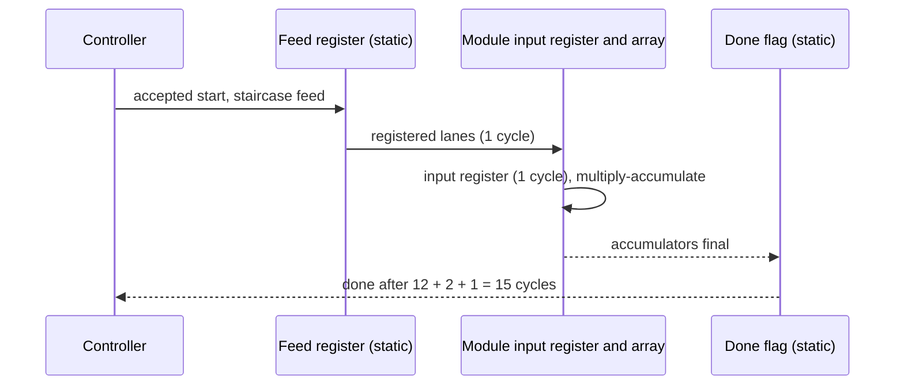
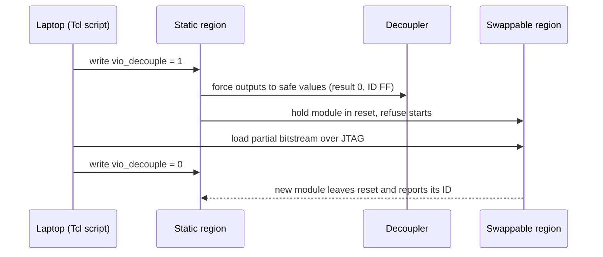

# T2 Complete Guide

**Dynamic Precision-Scalable Systolic Array using DFX**
Swapping the "number size" of a hardware calculator while it keeps running, on a ZedBoard FPGA.

*Who this is for:* someone smart who has never touched an FPGA. **Part I** (sections 1 to 11) explains T2 in plain language. **Part II** (sections 12 to 22) is the technical deep dive: design decisions, the hardware, verification, the Vivado build with its parent and child runs, the board session, the analysis and the lessons. Every technical word is explained the first time it appears. For the whole project (T0, T1, T2) see docs/PROJECT_DETAIL.md; for the live demo see docs/DEMO.md.

---

## 1. The one-minute version

- **What it is.** A small hardware calculator (a 4×4 grid, 16 tiny calculators) that multiplies tables of numbers (matrices). Matrix multiplication is the main workload of neural networks.
- **The trick.** The calculator can work with three "number sizes": 16-bit, 8-bit and 4-bit. Smaller numbers are less exact but cheaper. We can **swap between the three while the rest of the chip keeps running**, in about **0.43 seconds**.
- **How.** A Xilinx feature called Dynamic Function eXchange (DFX) lets us rewrite only one fenced-off region of the chip, not the whole thing.
- **Proof.** Every result the hardware produced matched a Python reference model exactly. 23 programming operations on the real board, no failures.
- **What we did not do.** No neural-network accuracy test, and no power measurement on the board (power figures are Vivado estimates). Those are future work (T3).

| Result | Value |
|---|---|
| Swap time between precisions (average of 12) | 0.43 s (full chip programming: 2.5 s) |
| Timing on a 100 MHz clock | met in all four builds (worst spare time +1.48 ns) |
| Board self-test | 14 of 14 steps passed, 58 of 58 checks |
| Live demo: same matrices on 16, 8 and 4 bits | 144 of 144 numbers matched the reference |
| Cost of 16-bit vs 8-bit vs 4-bit (lookup tables used) | 253 vs 1,451 vs 693 (16-bit uses 16 dedicated multipliers instead) |
| Estimated chip power (Vivado estimate, not measured) | 0.135 W (16-bit), 0.127 W (8-bit), 0.124 W (4-bit), 0.116 W (empty) |

---

## 2. The problem in everyday terms

A neural network is mostly one operation repeated billions of times: multiply two tables of numbers.

Numbers on a chip are stored with a fixed number of **bits** (binary digits). More bits means more precise but costs more chip area and energy. Think of measuring a table: a ruler with millimetre marks (16-bit) is more exact than one with centimetre marks (8-bit) or one with only 16 marks in total (4-bit). Sometimes "good enough" is fine and cheaper.

A normal chip design must pick one precision forever. We wanted the choice to be **changeable at run time**, without needing three separate calculators sitting on the chip.

---

## 3. The ideas you need

### 3.1 Matrix multiplication

Multiply row by column, add up the pieces:

```
A = | 1 2 |    B = | 5 6 |    C = A × B
    | 3 4 |        | 7 8 |

C[0][0] = 1×5 + 2×7 = 19      C[0][1] = 1×6 + 2×8 = 22
C[1][0] = 3×5 + 4×7 = 43      C[1][1] = 3×6 + 4×8 = 50
```

Each output needs a "multiply, then add to a running total" step. That step is called a **MAC** (multiply-accumulate).

### 3.2 The systolic array (an assembly line for MACs)

A **systolic array** is a grid of small calculators called **PEs** (processing elements). Each PE does one MAC per clock tick and passes its inputs to its neighbours, like buckets passed along a line.

Ours is **output-stationary**: PE(i, j) never moves its running total. It stays put and becomes output C[i][j]. Row values of A flow in from the west, column values of B from the north. Because neighbours get data one tick later, the inputs are fed in a **staircase**: row 1 starts one tick after row 0, row 2 one tick after that, and so on. That timing makes the right A and B values meet at the right PE. Our 4×4 grid has 16 PEs and finishes after 10 feed ticks.

### 3.3 Precision: what "int16, int8, int4" mean

"int" means whole number. The number is how many bits:

| Type | Range it can hold |
|---|---|
| int16 | −32,768 to 32,767 |
| int8 | −128 to 127 |
| int4 | −8 to 7 |

What if a value does not fit? Two options:

- **Saturate** (clamp to the limit): 200 in int8 becomes **127**. Like a thermometer that stops at its maximum.
- **Wrap** (keep only the low bits): 200 becomes **−56**. The sign flips, and the answer is silently wrong.

We always saturate.

### 3.4 Why the running total needs a bigger bucket

The sum of products is larger than the inputs. Worst case in int8: (−128) × (−128) = 16,384, and we add four of them = 65,536. That needs **18 bits** to store, not 8 or 17. For int4 the worst case is 4 × 64 = 256, which needs **10 bits**. For int16 the hardware uses 48 bits, and the final answer is clamped to 32 bits. (Rule of thumb: product bits double, plus 2 for adding four of them.)

### 3.5 Inside the FPGA: LUTs and DSPs

An **FPGA** is a chip full of reconfigurable logic. Two ingredients matter here:

- **LUT** (lookup table): a tiny programmable logic cell. You can build almost anything from thousands of them.
- **DSP slice**: a ready-made multiplier-adder baked into the chip. Fast and compact for 16-bit math.

Our int16 version uses 16 DSP slices (one per PE). Our int8 and int4 versions use **zero DSPs** and build their multipliers out of LUTs.

### 3.6 DFX: swapping part of the chip while the rest runs

Think of a house where you replace the furniture in one room while the rest of the house stays in use.

| House | Chip |
|---|---|
| The rest of the house | **Static region**: controller, debug link, LEDs, uptime counter. Never changes. |
| One fenced room | **Reconfigurable partition (RP)**, named `U_RP`, placed in a fenced area called a **Pblock** |
| The doorway, always the same size | **Frozen interface**: the same 180 wires cross the boundary for every module |
| Different furniture sets | **Reconfigurable modules (RMs)**: int16, int8, int4 |
| An empty room | **Greybox**: an RM that does nothing |
| New furniture delivery | **Partial bitstream**: a small file that rewrites only the fenced area |
| Closing the door during the move | **Decoupler**: forces the wires to safe values while the swap happens |

A **bitstream** is the file that configures an FPGA. A **full** bitstream rewrites everything (4.05 MB, 2.5 s). A **partial** one rewrites only the Pblock (0.59 MB, 0.43 s), and its size depends on the fenced area, not on what is inside.

---

## 4. What we built

```
  Laptop (Vivado) ──── JTAG cable ────▶ VIO debug core
                                         │ matrices A, B · start · pick-a-result
  ┌──────────────────────────────────────┴────────────────────────┐
  │  STATIC REGION (never reprogrammed in normal use)             │
  │   controller ─▶ feed registers ───────────┐                   │
  │   start gate · done flag                  │ 180 wires         │
  │   uptime counter · LEDs                   ▼                   │
  │                      ┌─────────────────────────────┐          │
  │                      │  SWAPPABLE REGION  U_RP     │          │
  │                      │  int16 │ int8 │ int4 │ empty│          │
  │                      └──────────────┬──────────────┘          │
  │   decoupler (the door) ◀────────────┘ results                 │
  └───────────────────────────────────────────────────────────────┘
```

- **Controller** (reused from the earlier tier T0) feeds the staircase of numbers.
- **Start gate:** a run is refused while the region is decoupled or held in reset. A `blocked` flag records any refused start.
- **VIO** (virtual input/output): a debug core that lets the laptop set switches and read values over the JTAG cable, no extra wiring needed.
- **Identity code:** each module reports an ID (16, 08 or 04; 00 for the empty one; FF while decoupled).
- **LEDs by design:** a blinking badge shows the loaded precision (four LEDs for int16, two for int8, one for int4) and a heartbeat LED proves the fixed part is alive.

### Timing of one calculation

The clock ticks 100 million times a second (10 ns per tick). The controller needs 12 ticks, plus 3 ticks for registers at the region boundary and the done flag: **15 ticks = 150 nanoseconds**, identical for every precision.

### How a swap works

1. Close the door (decouple). Results read as 0, the module ID reads FF, starts are refused.
2. Load the partial bitstream over JTAG (~0.43 s). The fixed part keeps running.
3. Re-open the door (release). The new module resets and reports its ID.
4. Load matrices, start, read results.

---

## 5. How we knew the answers were right

We wrote the maths twice: once in hardware, once in Python (the **golden model**). Every test compares the two exactly.

| Test case | What it catches |
|---|---|
| zeros, ones | Basic wiring |
| identity | Input clamping (multiplying by identity shows each value directly) |
| counting (1…16 and its transpose) | Row/column mix-ups |
| asym_small | Transposes that a symmetric test would hide |
| random_inrange | Ordinary arithmetic |
| random_full | Clamping at the array edge |
| extremes_neg, extremes_mix | Overflow and saturation |

The same files drive three checks: simulation, a pretend board, and the real board. Sample result for `counting`, element C[0][2] (row 0 of A times column 2 of B = 1×9 + 2×10 + 3×11 + 4×12): **110 in int16 and int8, but 70 in int4**, because int4 clamps every value above 7 down to 7.

We also ran **deliberately wrong builds** (the wrong module, a start gate forced open). Each one failed the tests, which proves the tests can detect mistakes. The board scripts were first rehearsed on a software mock of the board, which caught real bugs before the hardware was ever touched.

---

## 6. The build in Vivado

Vivado is Xilinx's design tool. We followed these stages:

1. **Create the project by script** (so it is exactly reproducible), with the fixed part plus three modules.
2. **Synthesis:** turn the Verilog code into LUTs and DSPs.
3. **Floorplan:** reuse the T1 fenced area in the right half of clock region **X1Y1**. That half contains DSP columns (the left half has none), so it can hold the int16 module. Capacity: 4,400 LUTs, 8,800 flip-flops, 40 DSPs, 10 block RAMs.
4. **Place and route** four configurations (int16, int8, int4, empty).
5. **Checks:** DRC (design-rule check) found 0 errors. `pr_verify` confirmed that all four builds have the identical fixed part, so any partial file fits any base design.

### Build results

| | int16 | int8 | int4 | empty |
|---|---|---|---|---|
| LUTs used by the swappable region | 253 | 1,451 | 693 | 179 |
| DSP slices | 16 | 0 | 0 | 0 |
| Share of the fenced area's LUTs | 5.75% | 32.98% | 15.75% | 4.07% |
| Worst setup slack (ns) | +2.135 | +1.481 | +2.981 | +2.981 |
| Worst hold slack (ns) | +0.088 | +0.088 | +0.088 | +0.088 |

**Reading the table:**
- **Slack** is spare time. A signal has 10 ns per tick; slack is how much is left on the slowest path. Positive means the timing is met. **Hold** slack checks that data does not change too early.
- The identical hold slack in all four builds is expected: the fixed part is locked and shared.
- The fixed part uses 1,300 LUTs and 2,659 flip-flops in every build (total minus the swappable region).
- The empty module still shows 179 LUTs. The report lists them as 179 one-input LUTs, one for each region wire except the clock: the cost of the interface itself.
- int4 is about 2.1 times smaller than int8 in LUTs, not 4 times: the adders, accumulators and control around the multipliers do not shrink with the number size.

Bitstream sizes: partial 585,559 bytes, full 4,045,666 bytes. We predicted one byte more for each, from T1's files. The file header stores the design's name, and `top_t2` is one character shorter than T1's `top_dfx`.

Vivado also estimates power for each build: 0.116 W (empty) to 0.135 W (int16). These are estimates from the tool, not measurements on the board; section 20 has the full table.

---

## 7. On the real board (22 October 2026)

Setup: ZedBoard, Vivado Hardware Manager, **JTAG clock 15 MHz**. A script (`hw_t2.tcl`) drives the board: it programs the files, writes matrices into the VIO, starts runs and reads results back.

What happened:

- Programmed the full int16 design, checked all 9 test cases: **9 of 9**. Swapped to int8, all 9: **9 of 9**.
- Start-gating test: starts were **refused** while decoupled and while the module was held in reset, and accepted after release.
- Live demo (same matrices through int16, int8, int4, int16): **144 of 144** numbers matched. For `counting`, int8 equals int16 but int4 differs in 15 of 16 elements. For `extremes_neg`, every element reads 2,147,483,647 (saturated, with overflow flag) in int16, 65,536 in int8, and 256 in int4.
- Self-test: 2 full programs and 12 swaps (int8, int4, empty, int16, three times). **14 of 14 steps passed.** The fixed part's uptime counter ran from 2 to 29 seconds without ever going backwards, so it was never disturbed. It reset only on the full re-programming, as designed.
- Total: **23 programming operations (19 partial, 4 full), none failed.**

Swap time: average **0.43 s** (range 0.41–0.52 s). It is the same for every module because the partial file has the same size.

**One prediction missed.** We expected about 1.4 s per swap. The measured 0.43 s is faster because this session's JTAG cable ran at 15 MHz, while the earlier T1 clock speed was not recorded. The effective speed was about 11 Mbit/s.

---

## 8. What this shows, and what it does not

**Shows**
- One fenced chip region can host three precision variants behind one frozen interface.
- Each variant matched the reference model bit for bit.
- Swapping takes under half a second and leaves the rest of the design running.
- Smaller precision trades accuracy for logic: the DSP-free modules cost 693 to 1,451 LUTs, while int16 costs 16 DSPs and 253 LUTs.

**Does not show**
- Neural-network accuracy (no MNIST or other workload was run).
- On-board power. The power figures are a Vivado vectorless estimate on the routed design, confidence Medium; not measured on the board.
- A full 9-case test of int4 on the board. int4 passed 5 case types in the self-test and 3 in the demo. The other four (identity, ones, zeros, random_inrange) passed in simulation only.
- LED behaviour in the log (designed and simulated, not recorded).
- Anything beyond one board, one JTAG speed and 12 timed swaps.

---

## 9. What comes next (T3 ideas, not started)

- Convert real-valued data to 16/8/4-bit integers on the host, run through each precision, and **measure the error against int16**.
- Try a small real workload, and measure power on the board.
- Close the int4 on-board test gap and photograph the LEDs.
- Explore larger arrays or more modules in the same region, and faster reconfiguration.

---

## 10. Glossary

| Term | Meaning |
|---|---|
| Accumulator | The running total inside a PE |
| Bit | One binary digit; n bits hold 2ⁿ values |
| Bitstream | File that configures the FPGA (full or partial) |
| Clock | The tick (100 MHz here) that paces the logic |
| DFX | Dynamic Function eXchange: reconfiguring part of an FPGA at run time |
| Decoupler | Logic that forces boundary wires to safe values during a swap |
| DRC | Design-rule check |
| DSP slice | Built-in multiplier-adder block |
| FPGA | Chip whose logic can be rewired by loading a file |
| Golden model | Trusted Python reference used to check hardware |
| Greybox | Empty module used as a blank or baseline |
| JTAG | Cable interface used to program and debug the chip |
| LUT | Small programmable logic cell |
| MAC | Multiply-accumulate step |
| Output-stationary | Each PE keeps one output's running total |
| Partition pin | A wire crossing the region boundary (180 here) |
| Pblock | The fenced physical area for the swappable region |
| PE | Processing element, one tile of the array |
| `pr_verify` | Vivado check that builds share an identical fixed part |
| RM / RP | Reconfigurable module / reconfigurable partition |
| Saturation | Clamping a value to the largest or smallest allowed |
| Slack | Spare time on a signal path (setup or hold) |
| Static region | The part of the chip that is never swapped |
| Systolic array | Grid of PEs passing data between neighbours |
| VIO | Debug core giving virtual switches and displays over JTAG |

---

## 11. Where the numbers come from

| Topic | File |
|---|---|
| Timing, resources, pin count, DRC | `docs/t2/reports/build_summary.csv` |
| Power estimate, worst-path delay, Fmax estimate | `docs/t2/reports/power_delay_summary.csv` |
| Compatibility check | `docs/t2/reports/pr_verify.rpt` |
| Simulation cycles and results | `docs/t2/reports/sim_cycles.csv`, `sim_summary.txt` |
| Bitstream sizes | `bitstreams/t2/manifest.csv` |
| Board session log | `docs/t2/reports/hw_session_20261022.log` |
| Self-test and demo data | `docs/t2/reports/hw_selftest_20261022_134926.csv`, `hw_demo_20261022_134038.csv` |
| Session summary and predictions | `docs/t2/T2_BOARD_RUNBOOK.md` (section F) |
| Design decisions and names | `docs/t2/T2_PLAN.md` |

---

## 12. Part II: the technical deep dive

Part I described the result in plain language. Part II follows the same T2 build from its frozen interface to the board evidence. T0 established the 4x4 int16 systolic array. T1 established the Dynamic Function eXchange (DFX) boundary and proved that a reconfigurable module could be swapped while the static design continued. T2 keeps that boundary and places int16, int8, int4, and greybox variants behind it.

The sections are ordered like the engineering work: decisions, architecture, RTL, reference model, verification, Vivado implementation, board operation, analysis, lessons, and reproduction. Tables use the names from reports and scripts. A number is a measured result only where a report, CSV, log, or plan records it.

The wider project history and the T0/T1 context are collected in `docs/PROJECT_DETAIL.md`. The live demonstration procedure is in `docs/DEMO.md`.

Part II treats a module as a replaceable calculator. The static top owns clocks, control, safety, and the board interface. The reconfigurable module owns only the arithmetic that changes. This split is why the bitstream can be partial and why the outside signals remain stable during a swap.

*Sources: docs/PROJECT_DETAIL.md, docs/t2/T2_PLAN.md, docs/DEMO.md*

## 13. The design decisions

These eleven decisions were written into the plan before any code. Each one is listed with the reason that settled it.

| # | Decision | Reason |
|---|---|---|
| D1 | The swappable region holds the input clamps, the 4×4 array and the result select | About 180 boundary wires instead of about 900; the static side never needs to know the precision |
| D2 | Every variant keeps 16-bit input lanes; each module clamps its own inputs at the array edge | One frozen interface; out-of-range values saturate instead of wrapping |
| D3 | int16 reuses the T0 PE on DSP slices; int8 and int4 use LUT multipliers; accumulators are 48 / 18 / 10 bits | A clean DSP-versus-LUT comparison with exact accumulator sizes |
| D4 | The T0 controller is reused unchanged; a registered feed stage and a start gate are added | Closes the start-gating requirement left open in T1 |
| D5 | A and B are loaded through two 256-bit VIO probes; results are read one at a time through a selector `sel` | Any matrix can run live; the same files drive simulation and board |
| D6 | Registers on both sides of the boundary | Every boundary path becomes register → wire → register; costs 2 cycles |
| D7 | The cycle count is identical for every precision by construction | Measured in simulation, not assumed |
| D8 | Reuse the T1 Pblock unchanged | Already proven on silicon; capacity 4,400 LUT, 8,800 FF, 40 DSP, 10 block RAM |
| D9 | Four configurations: int16, int8, int4 and an empty greybox | An empty-region control almost for free, because the child runs build in parallel |
| D10 | The Vivado project is created by a script; the builds are launched from the GUI | DFX setup is click-heavy and cannot be undone; a script is exact and reproducible |
| D11 | Module IDs 16 / 08 / 04 (00 empty, FF decoupled); an LED badge where lit LEDs = bits ÷ 4 | The loaded precision is readable at a glance |

**D1 in numbers.** The boundary carries 134 inputs, 45 outputs and the clock: 180 partition pins. A bare array would expose every accumulator, roughly 900 wires.

**D3 in practice.** The int16 module instantiates T0's `pe.v` and `array.v` unchanged, one DSP slice per PE. The int8 and int4 modules use `pe_lut.v`, marked `use_dsp = "no"`, so their multipliers are built from LUTs. The resource table confirms 16, 0, 0 and 0 DSP slices.

**D6 in practice.** One register sits on the static side and one inside the module. That adds 2 cycles to every run, the same for every precision, and gives every boundary path a full clock period.

**Accumulator widths.** A signed product needs twice the input width, and adding four products needs 2 more bits: 2×8 + 2 = 18 and 2×4 + 2 = 10. The early estimate of 17 and 9 bits was wrong because the clamp allows −128 and −8, and 4 × (−128)² = 65,536 needs 18 signed bits.

*Sources: docs/t2/T2_PLAN.md (section 2), rtl/t2/rm/rm_int16.v, rtl/t2/rm/pe_lut.v, docs/t2/reports/build_summary.csv*

## 14. The architecture in detail

The **static top** `top_t2` holds the reset synchroniser, the uptime counter and heartbeat, the VIO core, the T0 controller, the feed registers, the start gate, the done flag, the decoupler and the LED drivers. The **swappable region** `U_RP` holds only the arithmetic that changes.

- **Start gate.** A start is accepted only when the module is out of reset, the region is not decoupled and no run is busy. A refused start sets a sticky `blocked` flag, cleared by the next accepted start. Accepted starts increment a `runs` counter.
- **Decoupler.** 45 bits wide, one per output wire. While decoupled it outputs safe values: result 0, overflow 0, ID FF, LEDs off.
- **LEDs.** LD3..LD0 show the module's badge, LD4 the done flag, LD5 the decouple state, LD6 the module reset, LD7 the static heartbeat.

### The frozen boundary

| Signal | Width | Direction | Meaning |
|---|---:|---|---|
| `clk` | 1 | in | 100 MHz clock |
| `rst_n` | 1 | in | module reset, held low while decoupled |
| `clr_acc` | 1 | in | clear the accumulators at the start of a run |
| `west_bus` | 64 | in | four 16-bit A lanes from the static feed register |
| `north_bus` | 64 | in | four 16-bit B lanes from the static feed register |
| `sel` | 4 | in | which of the 16 results to output |
| `result` | 32 | out | C[sel] as a 32-bit signed number |
| `ovf` | 1 | out | the result was clamped (possible only in int16) |
| `rm_id` | 8 | out | module identity code |
| `led_pat` | 4 | out | LED badge pattern |

Inputs 134, outputs 45, plus the clock: 180 partition pins. The port list is byte-identical in all three module files.

### One calculation



The controller needs 12 cycles, the two boundary registers add 2, and the done flag adds 1: **15 cycles (150 ns) for every module and every test case**.

### One swap




*Vivado's elaborated schematic of `top_t2` (182 cells, 10 I/O ports, 968 nets): the static logic, with the swappable region `U_RP`, the VIO and the decoupler each shown as one block.*

*Sources: rtl/t2/top_t2.v, rtl/t2/rm/rm_int8.v, rtl/t1/dfx_decouple.v, docs/t2/T2_PLAN.md (sections 3 and 4)*

## 15. The hardware, module by module

| Module | Input stage | PE | Accumulator | Output | DSP slices |
|---|---|---|---:|---|---:|
| int16 | pass-through | T0 PE on a DSP slice | 48 bits | clamp 48 → 32 bits, sets `ovf` | 16 |
| int8 | clamp each lane to 8 bits | LUT multiplier | 18 bits | sign-extend to 32 bits | 0 |
| int4 | clamp each lane to 4 bits | LUT multiplier | 10 bits | sign-extend to 32 bits | 0 |
| greybox | none | none | none | Vivado ties every boundary wire with a one-input LUT | 0 |

The 4×4 array is a grid of 16 PEs. Each PE receives a value from the west and one from the north, multiplies them, adds the product to its own accumulator and passes the inputs on. The controller's staircase makes the right values meet at the right PE.

**Clamping happens on the way in.** int8 and int4 clamp each 16-bit lane once, at the array edge, to the full range of their width. The array then works on narrow numbers. On the way out, int16 clamps its 48-bit total to 32 bits and raises `ovf` when it does; int8 and int4 cannot overflow 32 bits, so they only sign-extend.

**Outputs are always driven by registers.** `rm_id`, the LED badge and the constant `ovf` of int8/int4 come from registers marked `dont_touch`, so Vivado cannot replace them with constants (gotcha G20). Every boundary wire is then driven by a flip-flop.

The clamp itself is three lines:

```verilog
// rm_common.v, module lane_sat: clamp a 16-bit lane to OUT_W bits
assign y = (x > HI) ? HI[OUT_W-1:0] :
           (x < LO) ? LO[OUT_W-1:0] :
                      x[OUT_W-1:0];
```

`HI` and `LO` are the largest and smallest values of the target width: 127 and −128 for int8, 7 and −8 for int4.

*Sources: rtl/t2/rm/rm_common.v, rtl/t2/rm/rm_int16.v, rtl/t2/rm/rm_int8.v, rtl/t2/rm/rm_int4.v, rtl/t2/rm/pe_lut.v, docs/t2/reports/cfg_grey_utilization_U_RP.rpt*

## 16. The reference model and the test cases

The Python golden model computes what each module must output, bit for bit: clamp the inputs to the precision, multiply, accumulate in the module's width, then convert to 32 bits. It writes one answer key per case and precision. The same files drive the simulation benches, the software mock of the board and the real board.

| Case | What it catches |
|---|---|
| zeros | reset and all-zero propagation |
| ones | basic accumulation (every result is 4) |
| identity | lane routing (C equals A) |
| counting | feed order; hand-checkable (C[0][2] = 110 in int16) |
| asym_small | transposes that a symmetric case would hide |
| random_inrange | ordinary arithmetic with values that fit every precision |
| random_full | input clamping at the array edge |
| extremes_neg | accumulator width and positive saturation (every input −32,768) |
| extremes_mix | negative saturation and sign handling (−32,768 times 32,767) |

**Precision-sensitive cases matter.** Small values give the same answer in every precision, so a wrong-width module could pass them. `random_full` and the two `extremes` cases give different answers per precision (gotcha G17).

**How matrices reach the chip.** A and B each travel as one 256-bit VIO probe: 16 values × 16 bits, written as 64 hex digits. The first hex digit is the top 4 bits of A[3][3]; the last four digits are A[0][0] (gotcha G18). Results are read one at a time: the script sets `sel` and reads one 32-bit value.

*Sources: python/golden_t2.py, python/gen_vectors_t2.py, python/test_golden_t2.py, scripts/t2/hw_t2.tcl, sim/t2_vectors, docs/t2/T2_PLAN.md (section 7)*

## 17. Verification before Vivado

The checks are layered, so a failure on the board has a small search area.

| Layer | What ran | Result |
|---|---|---|
| Golden model self-checks | `test_golden_t2.py` | ALL PASS |
| Region bench (`tb_rp_t2`), one build per module | 9 cases per module | 3 of 3 pass |
| Whole-design bench (`tb_top_t2`), one build per module | 9 cases per module, cycle counts, start gate | 3 of 3 pass |
| Negative builds | N1 int16 module in the int8 bench; N2 int8 module in the int4 bench; N3 start gate removed | 3 of 3 fail for the expected reason |
| Cycle count | 27 (module, case) pairs | 12 controller cycles (`CT_CYCLES`) and 15 start-to-done in every pair |
| Out-of-context synthesis | each module alone | all gates pass (table below) |
| Scratch project | the project script, including synthesis of all runs, in a throw-away folder | `SCRATCH OK` |

All benches ran in Vivado's XSim simulator. The installed Icarus Verilog 0.9.7 cannot read T0's two-dimensional net arrays, so it was used only as a compile check on the builds that do not include `rtl/array.v`.

**Out-of-context synthesis** builds each module alone, before the real project exists. Gates: at most 2,200 LUTs (half the fence), DSPs exactly 16 / 0 / 0, no block RAM, positive estimated slack.

| Module | LUT | FF | DSP | Estimated slack (ns) | Gates |
|---|---:|---:|---:|---:|---|
| rm_int16 | 254 | 166 | 16 | +5.246 | pass |
| rm_int8 | 1,442 | 600 | 0 | +2.631 | pass |
| rm_int4 | 597 | 336 | 0 | +4.139 | pass |

The LUT counts differ a little from the implemented design (253 / 1,451 / 693) because out-of-context synthesis sees each module without its surroundings.

*Sources: docs/t2/reports/sim_summary.txt, docs/t2/reports/sim_cycles.csv, docs/t2/reports/ooc_summary.csv, docs/t2/reports/scratch_validation.log, docs/t2/T2_PLAN.md (sections 8 and 16)*

## 18. The Vivado flow and the child runs

### 18.1 Creating the project by script

`create_project_t2.tcl` replaces a long series of GUI clicks. It creates the project for `xc7z020clg484-1`, adds the static sources, the constraints and the VIO core, defines the partition `pd_t2` on `U_RP`, adds the three modules, and creates the four configurations and their runs. The human then opened the project in the GUI, checked every object, and launched synthesis and implementation from there (decision D10).

### 18.2 The floorplan

The Zynq-7020's programmable logic is divided into six clock regions. A column of configuration sites runs through region X1Y1 at device grid position RPM_X 205 and splits it. The left part has no DSP column, so it could never hold the int16 module. The fence uses the right part:

```tcl
resize_pblock [get_pblocks pblock_U_RP] -add {SLICE_X80Y50:SLICE_X103Y99}
resize_pblock [get_pblocks pblock_U_RP] -add {DSP48_X3Y20:DSP48_X4Y39}
resize_pblock [get_pblocks pblock_U_RP] -add {RAMB18_X4Y20:RAMB18_X4Y39}
resize_pblock [get_pblocks pblock_U_RP] -add {RAMB36_X4Y10:RAMB36_X4Y19}
```

The Pblock utilisation report gives its capacity: 4,400 LUTs, 8,800 flip-flops, 40 DSP slices, 10 block RAMs. The largest module, int8, uses 1,451 LUTs, 32.98% of it.

### 18.3 Synthesis

Five synthesis runs: `synth_1` for the static design (the region is a black box there, as expected), `rm_int16_synth_1`, `rm_int8_synth_1`, `rm_int4_synth_1`, and `vio_t2_synth_1` for the VIO core. The greybox needs no synthesis; Vivado creates it during implementation.

### 18.4 Parent and child implementation runs

The **parent run** places and routes the whole design with the int16 module and locks the static region. Each **child run** reuses that locked static region and implements only its own module, so the three children run in parallel.

| Run | Configuration | Bitstreams produced |
|---|---|---|
| `impl_1` (parent) | `cfg_int16` | `top_t2.bit` (full), `U_RP_rm_int16_partial.bit` |
| `child_0_impl_1` | `cfg_int8` | `top_t2.bit` (full), `U_RP_rm_int8_partial.bit` |
| `child_1_impl_1` | `cfg_int4` | `top_t2.bit` (full), `U_RP_rm_int4_partial.bit` |
| `child_2_impl_1` | `cfg_grey` | `top_t2.bit` (full), `U_RP_greybox_partial.bit` |


*Vivado after implementation. Top right: the Device view with `U_RP`'s fence in the right part of clock region X1Y1. Bottom: the Design Runs table with the parent `impl_1` (cfg_int16) and the three child runs, each showing WNS, WHS and total power, plus the out-of-context synthesis runs of the VIO and the three modules.*


*The implemented parent design (`impl_1`, cfg_int16). Power panel: 0.135 W total on-chip, 0.032 W dynamic, 0.103 W static (a Vivado estimate). Timing panel: WNS 2.135 ns, WHS 0.088 ns, all constraints met.*

### 18.5 Results

| Configuration | WNS (ns) | WHS (ns) | Region LUT | Region FF | DSP |
|---|---:|---:|---:|---:|---:|
| int16 | +2.135 | +0.088 | 253 | 166 | 16 |
| int8 | +1.481 | +0.088 | 1,451 | 600 | 0 |
| int4 | +2.981 | +0.088 | 693 | 336 | 0 |
| greybox | +2.981 | +0.088 | 179 | 1 | 0 |

**WNS** (worst negative slack) is the spare time on the slowest path in a 10 ns clock period; positive means the timing is met. **WHS** (worst hold slack) checks that data does not change too early. WHS is identical in all four builds because the static region is locked and shared. The static region costs 1,300 LUTs and 2,659 flip-flops in every build (whole design minus the region). DRC reports 0 errors in all four builds, and `pr_verify` passes with 180 partition pins compared.

### 18.6 Collecting the bitstreams

`collect_bitstreams.py` copies the eight bitstreams and the probes file into `bitstreams/t2/`. Its staleness guard refuses any file older than its source checkpoint. `manifest.csv` records each file's size, SHA-256 checksum and source run. `verify_bundle.py` re-checks all nine files against the manifest and prints `BUNDLE OK`.

| File | Bytes |
|---|---:|
| `t2_full_{int16,int8,int4,grey}.bit` | 4,045,666 each |
| `t2_partial_{int16,int8,int4,grey}.bit` | 585,559 each |
| `t2_full_int16.ltx` (probes file) | 110,316 |

One probes file serves every programming step, because the VIO lives in the static region and never changes.

*Sources: scripts/t2/create_project_t2.tcl, constraints/top_t2_pblock.xdc, docs/t1/T1_Complete_Guide.md, docs/t2/reports/build_summary.csv, docs/t2/reports/cfg_int16_utilization_pblock.rpt, docs/t2/reports/pr_verify.rpt, bitstreams/t2/manifest.csv*

## 19. The board session (2026-10-22)

### 19.1 Setup and commands

ZedBoard, Vivado Hardware Manager, JTAG clock **15,000,000 Hz** (printed by `t2_connect`). The script `hw_t2.tcl` wraps the Hardware Manager commands:

| Command | What it does | Vivado operation underneath |
|---|---|---|
| `t2_connect` | connect to the board | `open_hw_manager`, `connect_hw_server`, `open_hw_target` |
| `t2_program full int16` | load the full design | set `PROGRAM.FILE` and `PROBES.FILE`, `program_hw_devices` |
| `t2_probes` | find the 11 VIO probes by name | `get_hw_vios`, `get_hw_probes` |
| `t2_check ones` | load one case, run it, compare with the golden file | set `OUTPUT_VALUE`, `commit_hw_vio`, `refresh_hw_vio`, read `INPUT_VALUE` |
| `t2_swap_demo int8` | decouple, load a partial, release, verify | VIO writes plus `program_hw_devices` |
| `t2_status` | read ID, uptime, flags and run count | `refresh_hw_vio`, read `INPUT_VALUE` |

### 19.2 Session sequence

1. Full int16 loaded; all 11 probes resolved; `ones` passed.
2. All 9 cases on int16: 9 of 9. Swap to int8 (431 ms), all 9 cases: 9 of 9.
3. Start-gating test: refused while decoupled and while the module was held in reset; accepted after release.
4. Demo: the same three cases through int16, int8, int4, then back to int16.
5. Swap to greybox and back to int16; full-program contrast (uptime reset 1,006 → 0 s, as expected).
6. Self-test: 2 full programs and 12 swaps.

The planned int4 swap and 9-case int4 sweep (runbook rows 10 and 11) were skipped. int4 was exercised in the demo and in the self-test.

### 19.3 Demo result

| Case | int16 C[0][2] | int8 C[0][2] | int4 C[0][2] | Elements equal to int16 (int8 / int4) |
|---|---:|---:|---:|---|
| counting | 110 | 110 | 70 | 16 / 1 |
| random_full | −184,541,856 | 256 | 16 | 0 / 0 |
| extremes_neg | 2,147,483,647 (overflow) | 65,536 | 256 | 0 / 0 |

144 rows (3 cases × 3 precisions × 16 elements), 0 mismatches against the golden model. In `extremes_neg`, all 16 int16 elements saturate with the overflow flag set. Demo swaps: int8 417 ms, int4 416 ms.

### 19.4 Self-test

| Step | Operation | ms | Uptime before → after (s) | ID | Cases | Verdict |
|---:|---|---:|---|---|---:|---|
| 1 | full int16 | 2,504 | – → 2 | 16 | 5/5 | PASS |
| 2 | full int16 | 2,497 | 3 → 0 | 16 | 5/5 | PASS |
| 3 | partial int8 | 421 | 2 → 3 | 08 | 5/5 | PASS |
| 4 | partial int4 | 436 | 5 → 6 | 04 | 5/5 | PASS |
| 5 | partial grey | 415 | 7 → 8 | 00 | 1/1 | PASS |
| 6 | partial int16 | 419 | 9 → 10 | 16 | 5/5 | PASS |
| 7 | partial int8 | 418 | 12 → 12 | 08 | 5/5 | PASS |
| 8 | partial int4 | 436 | 14 → 15 | 04 | 5/5 | PASS |
| 9 | partial grey | 416 | 17 → 18 | 00 | 1/1 | PASS |
| 10 | partial int16 | 414 | 18 → 19 | 16 | 5/5 | PASS |
| 11 | partial int8 | 518 | 21 → 22 | 08 | 5/5 | PASS |
| 12 | partial int4 | 427 | 24 → 25 | 04 | 5/5 | PASS |
| 13 | partial grey | 421 | 27 → 28 | 00 | 1/1 | PASS |
| 14 | partial int16 | 411 | 28 → 29 | 16 | 5/5 | PASS |

14 of 14 steps, 58/58 case checks. The five cases per step are `counting`, `asym_small`, `random_full`, `extremes_neg` and `extremes_mix`; the greybox step runs one case, `counting`, against the empty module's expected output.

| Statistic | Partial swaps | Full programs |
|---|---:|---:|
| N | 12 | 2 |
| Mean (ms) | 429.3 | 2,500.5 |
| Standard deviation (ms) | 29.1 | – |
| Min – max (ms) | 411 – 518 | 2,497 – 2,504 |

Whole session: **23 programs (19 partial, 4 full), none failed.**

### 19.5 The software mock

Before the lab, `hw_t2_mock.tcl` replaced the Hardware Manager with a software model of the board: programming, VIO reads and writes, decoupling, module IDs, uptime and answers. It runs **22 positive checks** and **5 deliberate faults**, each of which must be caught: a partial that resets uptime, reversed probe lanes, int8 without its input clamp, a start accepted while decoupled, and a partial loaded onto a blank chip. The mock caught two real script bugs before the board was touched (section 21).

The only warnings in the session log are `[Labtools 27-1952]` after full programs: Vivado's cached VIO values differ from the freshly reset chip. They are harmless; the script rewrites the values before reading.

*Sources: docs/t2/reports/hw_session_20261022.log, docs/t2/reports/hw_demo_20261022_134038.csv, docs/t2/reports/hw_selftest_20261022_134926.csv, docs/t2/T2_BOARD_RUNBOOK.md (section F), scripts/t2/hw_t2.tcl, scripts/t2/hw_t2_mock.tcl*

## 20. What the numbers mean

### 20.1 Resources, delay and power

| Configuration | LUTs, whole design | LUTs, swappable region | DSPs | Worst-path delay (ns) | Estimated Fmax (MHz) | Total power (W) | Dynamic power (W) |
|---|---:|---:|---:|---:|---:|---:|---:|
| int16 | 1,553 | 253 | 16 | 7.732 | 127.1 | 0.135 | 0.032 |
| int8 | 2,751 | 1,451 | 0 | 8.538 | 117.4 | 0.127 | 0.021 |
| int4 | 1,993 | 693 | 0 | 6.532 | 142.5 | 0.124 | 0.017 |
| Empty (greybox) | 1,479 | 179 | 0 | 6.532 | 142.5 | 0.116 | 0.013 |

- **Dynamic power rises with precision:** int16 > int8 > int4 > empty. Static power (0.103 to 0.106 W) is most of the total and barely changes.
- **int4 and empty share the same worst path.** The timing reports place it inside the VIO debug core in the static region, with no logic between the two registers. In those two builds the swappable region is not the slowest part.
- **All four designs met timing and were tested at 100 MHz.** The Fmax column is an estimate, 1000 / (10 − WNS), not a tested clock speed.

**How to read the columns.** *Worst-path delay* is the signal travel time on the slowest path. *Estimated Fmax* uses the slack, which also counts clock skew and setup time, so it is not simply 1000 ÷ delay. *Power* is a **Vivado vectorless estimate on the routed design, confidence Medium; not measured on the board**. "Vectorless" means Vivado assumes default switching rates instead of using recorded signal activity.

| Configuration | Slowest path | Logic levels | Where |
|---|---|---:|---|
| int16 | VIO select probe → overflow register in the module's readout | 6 | crosses into the swappable region |
| int8 | module input register → accumulator of the PE in row 0, column 2 | 11 | inside the swappable region: an int8 multiply-accumulate |
| int4, empty | one VIO-core register → another | 0 | static region (VIO debug core) |

A *logic level* is one logic cell a signal passes through between two registers.

### 20.2 The DSP-versus-LUT trade

- **int16 is the cheapest in LUTs** (253) because its 16 multipliers are DSP slices: one per PE, one multiply-accumulate each.
- **int8 and int4 use no DSP slices on purpose** (decision D3), so the comparison shows what a multiplier costs in LUTs.
- **int4 is about 2.1 times smaller than int8, not 4 times.** The multipliers shrink, but the adders, accumulators, registers and readout shrink less.
- **The empty module's 179 LUTs are the interface.** The greybox utilisation report lists exactly 179 one-input LUTs: one per non-clock boundary wire.

### 20.3 Swap time

The 12 partial swaps average 429.3 ms at a 15 MHz JTAG clock. That is 585,559 bytes in 0.4293 s, about 10.9 Mbit/s (1.36 MB/s); the full programs reach about 12.9 Mbit/s. A two-point fit gives 0.599 µs per byte plus 0.079 s fixed overhead. T1's fit was 2.21 µs per byte plus 0.13 s, at a JTAG clock that was not recorded. Swap time does not depend on precision, because every partial bitstream rewrites the same fenced area and has the same size.

**Continuity.** With programs under one second, the uptime check reduces to "the counter did not go backwards". The stronger evidence is the full sequence: uptime ran from 2 to 29 s across 12 swaps without a reset, and reset only on the full programs.

### 20.4 Predictions versus measurements

| # | Prediction (written before the build) | Measured | Held? |
|---|---|---|---|
| P1 | Every partial 585,560 B | 585,559 B | within 1 byte: the bitstream header names the top module, and `top_t2` is one character shorter than T1's `top_dfx` |
| P2 | Every full 4,045,667 B | 4,045,666 B | within 1 byte, same reason |
| P3 | Swap about 1.42 s | 429.3 ms mean | not held: faster JTAG clock this session |
| P4 | DSP 16 / 0 / 0 / 0 | 16 / 0 / 0 / 0 | held |
| P5 | int8 LUTs > int4 LUTs | 1,451 > 693 | held |
| P6 | Same latency for every module | 12 and 15 cycles in all 27 pairs | held (simulation) |
| P7 | Static LUT/FF above T1's 636 / 1,412 | 1,300 / 2,659 | held |
| P8 | WNS ≥ 0 in all four; worst path in the controller or an int8 multiply-accumulate | WNS +1.481 to +2.981 ns; the int8 worst path is a multiply-accumulate | held |
| P9 | Board results bit-exact with the golden files | int16 9/9, int8 9/9, int4 5 case types; 144/144 demo values | held, with the int4 gap in section 22 |

*Sources: docs/t2/reports/power_delay_summary.csv, docs/t2/reports/build_summary.csv, docs/t2/reports/cfg_*_timing_summary.rpt, docs/t2/reports/cfg_*_power.rpt, docs/t2/reports/cfg_grey_utilization_U_RP.rpt, docs/t2/reports/hw_selftest_20261022_134926.csv, bitstreams/t2/manifest.csv, docs/t2/T2_PLAN.md (section 12)*

## 21. Bugs, deviations and lessons

### 21.1 As-built deviations from the plan

| # | What changed | Why |
|---|---|---|
| 1 | All benches ran in XSim; Icarus kept only as a compile check | The installed Icarus 0.9.7 rejects T0's two-dimensional net arrays |
| 2 | The reused controller has an extra `running` output, wired to an unused net | Found by reading `controller.v` before freezing the interface |
| 3 | Existing quantisation helpers reused; hex width rounded up for 10- and 18-bit values | The helpers matched the full-range clamp on every int16 input |
| 4 | Lowercase hex in every vector file | The plan did not specify it; matches T0 |
| 5 | Board script accepts both the locked VIO net names and known aliases | Synthesis can rename nets |
| 6 | Constant outputs driven by internal `dont_touch` registers | Keeps every boundary wire flop-driven |
| 7 | The LUT array uses flat buses instead of two-dimensional arrays | Lets the int8/int4 builds pass the Icarus compile check |
| 8 | Vivado batch jobs launched from PowerShell | From Git Bash, synthesis failed with `couldn't read file` |
| 9 | The project script moves the shared module file into place | Vivado's `-define_from` moved only some files |
| 10 | The project path is accepted only as an absolute path | A stray argument can never redirect the real project |
| 11 | A cache folder under `scripts/t1/` was kept | T1 files are read-only |
| 12 | DFX command forms copied from T1's Vivado journal | Known-good syntax instead of memory |

### 21.2 Gotchas new in T2

| # | Gotcha | Rule |
|---|---|---|
| G16 | Accumulator width | 18 and 10 bits, not 17 and 9 |
| G17 | Precision-blind vectors | Tests must include `random_full` and `extremes_*` |
| G18 | 256-bit probe order | First hex digit = top 4 bits of A[3][3]; last four digits = A[0][0] |
| G19 | Tcl and hex | `08` through `expr` is an invalid octal number; build hex with `format` |
| G20 | Constant outputs | Drive them from `dont_touch` flops |
| G21 | Module file lists | One list, in `t2_filesets.tcl` |
| G22 | Edits during a build | Sources are frozen between the `t2-rtl` and `t2-built` tags |
| G23 | Two Vivado sessions | Batch jobs only in the scratch folder while the GUI builds |
| G24 | Wrong-tier bitstreams | The board script refuses any file not in the T2 manifest |
| G25 | Stale results after a swap | Decouple clears the done flag; always re-run before reading |
| G26 | Old Icarus | Benches run in XSim |
| G27 | Probe names | Keep the `vio_*` net names exactly; the probes file uses them |
| G28 | Git Bash | Launch Vivado batch jobs from PowerShell or cmd |
| G29 | Black-box warning | Opening the static synthesis checkpoint alone warns about the VIO; expected |

### 21.3 Lessons

- The board-script mock caught two real bugs before the hardware was touched: a hex string passed through Tcl's `expr` (`00007E45` became a floating-point number) and a bracket error in a format string.
- T1's console log was lost to copy-paste, so T2's session was logged to a file from the start.
- A visual Markdown editor silently rewrote tables and code blocks on save; documents are edited as plain text.

*Sources: docs/t2/T2_PLAN.md (sections 13 and 16), docs/t2/T2_BOARD_RUNBOOK.md, scripts/t2/hw_t2_mock.tcl*

## 22. Limits, next steps and how to reproduce

### 22.1 Limits

- **int4 never got the 9-case sweep on the board.** It passed 5 case types in the self-test (3 rounds) and 3 in the demo. Not run on int4: `identity`, `ones`, `zeros`, `random_inrange` (all pass in simulation).
- **LED behaviour is not in the log.** It comes from the RTL and the plan; `docs/DEMO.md` asks for photos at the next session.
- **Power is a Vivado vectorless estimate on the routed design, confidence Medium; not measured on the board.**
- **No neural-network workload** and no accuracy measurement.
- **One board, one JTAG clock, 12 timed swaps.** Fmax figures are estimates; only 100 MHz was tested.

### 22.2 Next steps (T3, not started)

Host-side quantisation of real data, error against int16, a small real workload, on-board power measurement, and closing the int4 gap.

### 22.3 Reproduce T2 from a clean clone

1. Run `python python/test_golden_t2.py` (expect ALL PASS) and generate the vectors with `gen_vectors_t2.py`.
2. Run `python scripts/t2/run_sims.py` (expect ALL PASS and NEGATIVE OK).
3. From `vivado/scratch_t2/`, run `ooc_check.tcl` in Vivado batch mode from PowerShell.
4. In the Vivado GUI, source `create_project_t2.tcl`, check the Pblock and DRC, then run synthesis and implementation.
5. Run `reports_t2.tcl` and `power_delay_t2.tcl` in batch mode, then `collect_bitstreams.py`.
6. Run `hw_t2_mock.tcl` (expect MOCK TESTS PASS and NEGATIVE MOCKS OK) and `verify_bundle.py` (expect BUNDLE OK).
7. On the board: `t2_connect`, `t2_program full int16`, then any `t2_*` command from section 19.1.

### 22.4 T2 file map

| Area | Files |
|---|---|
| RTL | `rtl/t2/top_t2.v`, `rtl/t2/rm/*.v`; reused `rtl/controller.v`, `rtl/pe.v`, `rtl/array.v`, `rtl/t1/rst_sync.v`, `rtl/t1/uptime.v`, `rtl/t1/dfx_decouple.v` |
| Constraints | `constraints/top_t2.xdc`, `constraints/top_t2_pblock.xdc` |
| Simulation | `tb/t2/*`, `sim/t2_vectors/*` |
| Python | `python/golden_t2.py`, `python/gen_vectors_t2.py`, `python/test_golden_t2.py` |
| Build scripts | `scripts/t2/create_project_t2.tcl`, `t2_filesets.tcl`, `ooc_check.tcl`, `reports_t2.tcl`, `power_delay_t2.tcl` |
| Board scripts | `scripts/t2/hw_t2.tcl`, `hw_t2_mock.tcl`, `verify_bundle.py`, `collect_bitstreams.py` |
| Evidence | `docs/t2/reports/*`, `bitstreams/t2/manifest.csv` |
| Images | `docs/t2/img/rtl_schematic.png`, `Child_runs_impl.png`, `impl.png` |
| Documents | `docs/t2/T2_PLAN.md`, `docs/t2/T2_BOARD_RUNBOOK.md`, `docs/DEMO.md`, `docs/PROJECT_DETAIL.md` |
| Course source package | `submission/T2_final/` (self-contained copy of everything above that T2 needs), index in `submission/README.txt` |

*Sources: docs/t2/T2_PLAN.md, docs/t2/T2_BOARD_RUNBOOK.md, scripts/t2/*
